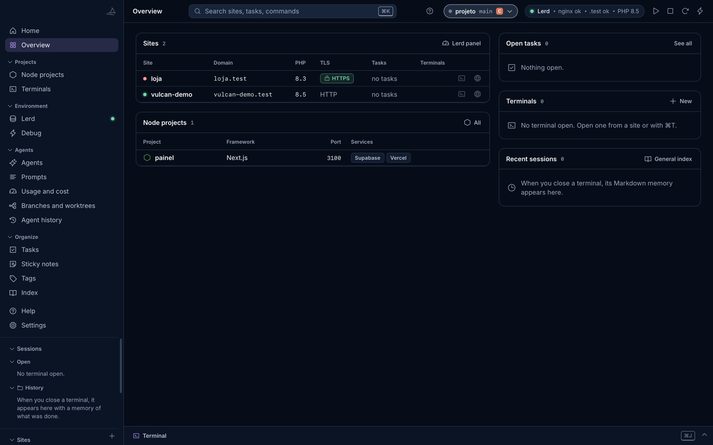

# Vulcan Celox

> Formerly Vulcan Terminal. Your data and key move to the new names by themselves.

**English** | [Português](README.pt-BR.md)

A desktop panel for developers who work alone with code agents. Real terminals, the sessions of Claude Code and Codex read straight from disk, prompts sent with one click, local PHP and Node projects, and a notebook for each project, in one native app.



**Status:** the latest stable release is 1.1.1, for macOS. Version 1.2.0 is on `main`, with test builds for Windows and Linux on the [Releases](https://github.com/freddominugez/vulcan-celox/releases) page. Neither test build has been accepted on a real machine yet. The interface is in English by default, with Portuguese available from ⌘K.

## Why it exists

Agents write code faster than one person can track. After a few parallel sessions it is hard to say which branch has unpublished work, which agent is stuck repeating the same test, and which terminal belongs to which session. Vulcan Celox answers those questions by reading the session files that the agents already write, without an API key and without writing to their folders.

## Features

| Area | What you get |
|------|--------------|
| **Agents** | Claude Code and Codex sessions with project, branch, files touched, commands, publication trail (edit, commit, push, PR) and a possible-loop alert |
| **History** | Search across requests, answers, commands and files of both agents |
| **Prompts** | Reusable prompts filled in from the session and pasted into the agent, **never sent without your Enter** |
| **Usage and cost** | Tokens and estimated cost at API list prices, by day, project, model and session |
| **Branches** | Sessions cross-checked with real git: no commit, no push, no upstream, open PR, stale worktree |
| **Harness** | A project's contract, items, next item, last green commit and handoff |
| **Terminals** | Real PTYs with tabs, color themes, split, search and a bottom panel; each session leaves a Markdown memory |
| **PHP sites** | Sites, PHP versions, services and dumps through [Lerd](https://github.com/lerd-env/lerd) or Laravel Valet |
| **Node projects** | Scripts in a visible terminal, local Supabase, Vercel link status |
| **Notebook** | Tasks, sticky notes, tags and a generated index |

## Install

**macOS**

1. Download the `.dmg` from [Releases](https://github.com/freddominugez/vulcan-celox/releases).
2. Drag **Vulcan Celox** to Applications.
3. The app is not signed by Apple. The first time, right click it, choose **Open** and confirm.

Requires macOS 13+ (Apple Silicon or Intel) and Python 3.9+. If Python is missing, the app offers to install it.

**Windows and Linux (test builds).** Download the `.zip` for Windows, with Python included, or the `.deb` or `.tar.gz` for Linux from the pre-release on [Releases](https://github.com/freddominugez/vulcan-celox/releases). Lerd and Valet are not available on Windows.

Details, limits and building from source: [docs/en/installation.md](docs/en/installation.md).

## Principles

- **Local.** The server listens only on `127.0.0.1` with a per-run token. No telemetry. Nothing leaves your machine unless you ask: AI documentation runs on click, and the GitHub PR lookup is off by default.
- **Read-only toward agents.** The app never writes to `~/.claude` or `~/.codex`. The one exception is the optional pairing hook, which you install yourself and which keeps a backup.
- **Nothing is deleted for good.** Removed folders go to the Trash.
- **Zero dependencies to install.** Python standard library, a web interface with no build step, a thin Swift shell. xterm.js is vendored.
- **AI only on click.** Session documentation calls Anthropic with your own key, stored in the Keychain, after showing what will be sent.

## Documentation

| | English | Português |
|---|---------|-----------|
| Documentation index | [docs/en](docs/en/README.md) | [docs/pt-BR](docs/pt-BR/README.md) |
| Installation | [installation](docs/en/installation.md) | [instalação](docs/pt-BR/installation.md) |
| User guide | [user-guide](docs/en/user-guide.md) | [manual](docs/pt-BR/user-guide.md) |
| **Technical manual** | [technical-manual](docs/en/technical-manual.md) | [manual técnico](docs/pt-BR/technical-manual.md) |
| Architecture overview | [architecture](docs/en/architecture.md) | [arquitetura](docs/pt-BR/architecture.md) |
| HTTP API | [http-api](docs/en/http-api.md) | [API](docs/pt-BR/http-api.md) |
| Agent file formats | [formats](docs/en/agent-file-formats.md) | [formatos](docs/pt-BR/agent-file-formats.md) |
| Configuration | [configuration](docs/en/configuration.md) | [configuração](docs/pt-BR/configuration.md) |
| Security model | [security](docs/en/security.md) | [segurança](docs/pt-BR/security.md) |
| Development and tests | [development](docs/en/development.md), [testing](docs/en/testing.md) | [desenvolvimento](docs/pt-BR/development.md), [testes](docs/pt-BR/testing.md) |
| Troubleshooting | [troubleshooting](docs/en/troubleshooting.md) | [problemas](docs/pt-BR/troubleshooting.md) |
| **Development history** | [history](docs/en/history.md) | [história](docs/pt-BR/history.md) |
| **Roadmap** | [ROADMAP](ROADMAP.md) | [ROADMAP](ROADMAP.pt-BR.md) |

Also: [CHANGELOG](CHANGELOG.md), [CONTRIBUTING](CONTRIBUTING.md), [SECURITY](SECURITY.md), [CODE OF CONDUCT](CODE_OF_CONDUCT.md).

## Repository layout

| Folder | What it holds |
|--------|---------------|
| `vulcan_celox/` | The app: Python core and server, web interface |
| `packaging/` | Swift shell for macOS, launchers for Linux and Windows, package sources |
| `scripts/` | Build, packaging and the validation script |
| `tests/` | Automated tests and anonymized fixtures |
| `docs/` | Documentation in English and Portuguese |

## Quick start for contributors

```bash
bash scripts/build_app.sh && open "dist/Vulcan Celox.app"   # build and open the app
python3 -m vulcan_celox --serve     # local server only, prints the port
python3 -m unittest discover -s tests -t .   # tests only
bash scripts/validate.sh               # all sensors (macOS, needs Command Line Tools)
```

## How it is built

The creation of this code was assisted by AI. Every change goes through the tests and `scripts/validate.sh`.

## License

[MIT](LICENSE). Third-party code in `vulcan_celox/web/vendor` is MIT too: see [LICENSES.md](vulcan_celox/web/vendor/LICENSES.md).

Vulcan Celox is independent and is not affiliated with Anthropic, OpenAI, Laravel, Lerd, Supabase or Vercel. Product names belong to their owners.

## Contact

[manager@byvulcan.com](mailto:manager@byvulcan.com)
