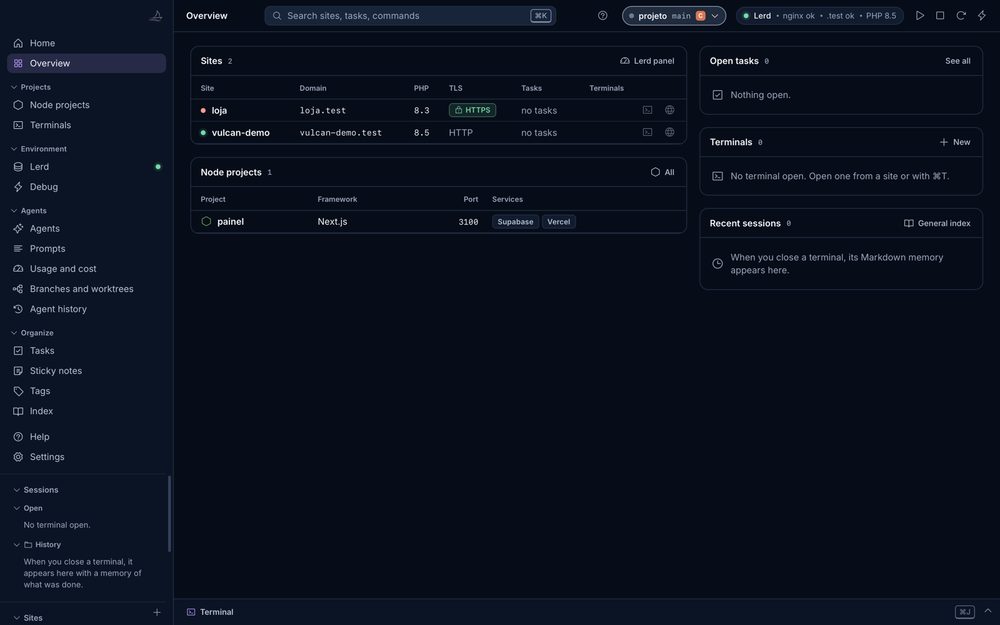

# Vulcan Celox

> Antes se chamava Vulcan Terminal. Seus dados e sua chave passam sozinhos para os nomes novos.

[English](README.md) | **Português**

Um painel desktop para quem programa sozinho com agentes de código. Terminais reais, as sessões do Claude Code e do Codex lidas direto do disco, prompts enviados com um clique, projetos locais PHP e Node e um caderno por projeto, num app nativo só.



**Situação:** a versão estável mais recente é a 1.2.1, para macOS. As versões de teste mais recentes para Windows e Linux estão na página de [Releases](https://github.com/freddominugez/vulcan-celox/releases). Nenhuma das versões de teste foi aceita ainda numa máquina real. A interface vem em inglês, com português disponível no ⌘K.

## Por que existe

Agentes escrevem código mais rápido do que uma pessoa consegue acompanhar. Depois de algumas sessões em paralelo fica difícil dizer qual branch tem trabalho sem publicar, qual agente está preso repetindo o mesmo teste e qual terminal é de qual sessão. O Vulcan Celox responde a isso lendo os arquivos de sessão que os agentes já gravam, sem chave de API e sem escrever nas pastas deles.

## Recursos

| Área | O que oferece |
|------|---------------|
| **Agentes** | Sessões do Claude Code e do Codex com projeto, branch, arquivos tocados, comandos, trilha de publicação (edição, commit, push, PR) e alerta de possível loop |
| **Histórico** | Busca em pedidos, respostas, comandos e arquivos dos dois agentes |
| **Prompts** | Prompts reutilizáveis, preenchidos pela sessão e colados no agente, **nunca enviados sem o seu Enter** |
| **Uso e custo** | Tokens e custo estimado no preço da API, por dia, projeto, modelo e sessão |
| **Branches** | Sessões cruzadas com o git real: sem commit, sem push, sem upstream, PR aberto, worktree parada |
| **Harness** | Contrato, itens, próximo item, último commit verde e handoff de um projeto |
| **Terminais** | PTYs reais com abas, temas de cor, divisão, busca e painel inferior; cada sessão deixa uma memória em Markdown |
| **Sites PHP** | Sites, versões de PHP, serviços e dumps pelo [Lerd](https://github.com/lerd-env/lerd) ou pelo Laravel Valet |
| **Projetos Node** | Scripts num terminal à vista, Supabase local e vínculo com a Vercel |
| **Caderno** | Tarefas, post-its, tags e um índice gerado |

## Instalar

**macOS**

1. Baixe o `.dmg` em [Releases](https://github.com/freddominugez/vulcan-celox/releases).
2. Arraste o **Vulcan Celox** para Aplicativos.
3. O app não é assinado pela Apple. Na primeira vez, clique com o botão direito, escolha **Abrir** e confirme.

Requer macOS 13+ (Apple Silicon ou Intel) e Python 3.9+. Se faltar Python, o app oferece instalar.

**Windows e Linux (versões de teste).** Baixe o `.zip` para Windows, com Python incluído, ou o `.deb` ou `.tar.gz` para Linux na pre-release em [Releases](https://github.com/freddominugez/vulcan-celox/releases). Lerd e Valet não existem no Windows.

Detalhes, limites e como compilar: [docs/pt-BR/installation.md](docs/pt-BR/installation.md).

## Princípios

- **Local.** O servidor só atende em `127.0.0.1`, com token por execução. Sem telemetria. Nada sai da máquina sem você pedir: a documentação com IA roda por clique, e a consulta de PR ao GitHub vem desligada.
- **Só leitura diante dos agentes.** O app nunca escreve em `~/.claude` ou `~/.codex`. A única exceção é o hook opcional de pareamento, instalado por você, com backup.
- **Nada é apagado de vez.** Pastas removidas vão para a Lixeira.
- **Nada para instalar.** Biblioteca padrão do Python, interface web sem build e uma casca fina em Swift. O xterm.js é vendorizado.
- **IA só no clique.** A documentação de sessão chama a Anthropic com a sua própria chave, guardada no Keychain, depois de mostrar o que será enviado.

## Documentação

| | Português | English |
|---|-----------|---------|
| Índice da documentação | [docs/pt-BR](docs/pt-BR/README.md) | [docs/en](docs/en/README.md) |
| Instalação | [instalação](docs/pt-BR/installation.md) | [installation](docs/en/installation.md) |
| Manual do usuário | [manual](docs/pt-BR/user-guide.md) | [user-guide](docs/en/user-guide.md) |
| **Manual técnico** | [manual técnico](docs/pt-BR/technical-manual.md) | [technical-manual](docs/en/technical-manual.md) |
| Visão da arquitetura | [arquitetura](docs/pt-BR/architecture.md) | [architecture](docs/en/architecture.md) |
| API HTTP | [API](docs/pt-BR/http-api.md) | [http-api](docs/en/http-api.md) |
| Formatos dos agentes | [formatos](docs/pt-BR/agent-file-formats.md) | [formats](docs/en/agent-file-formats.md) |
| Configuração | [configuração](docs/pt-BR/configuration.md) | [configuration](docs/en/configuration.md) |
| Modelo de segurança | [segurança](docs/pt-BR/security.md) | [security](docs/en/security.md) |
| Desenvolvimento e testes | [desenvolvimento](docs/pt-BR/development.md), [testes](docs/pt-BR/testing.md) | [development](docs/en/development.md), [testing](docs/en/testing.md) |
| Solução de problemas | [problemas](docs/pt-BR/troubleshooting.md) | [troubleshooting](docs/en/troubleshooting.md) |
| **História do desenvolvimento** | [história](docs/pt-BR/history.md) | [history](docs/en/history.md) |
| **Roadmap** | [ROADMAP](ROADMAP.pt-BR.md) | [ROADMAP](ROADMAP.md) |

Também: [Registro de mudanças](CHANGELOG.pt-BR.md), [Como contribuir](CONTRIBUTING.pt-BR.md), [Segurança](SECURITY.pt-BR.md), [Código de conduta](CODE_OF_CONDUCT.pt-BR.md).

## Organização do repositório

| Pasta | O que tem |
|-------|-----------|
| `vulcan_celox/` | O app: núcleo e servidor em Python, interface web |
| `packaging/` | Casca Swift do macOS, inicializador e pacotes do Linux |
| `scripts/` | Build, pacotes e o script de validação |
| `tests/` | Testes automatizados e fixtures anonimizadas |
| `docs/` | Documentação em inglês e português |

## Início rápido para contribuir

```bash
bash scripts/build_app.sh && open "dist/Vulcan Celox.app"   # compila e abre o app
python3 -m vulcan_celox --serve     # só o servidor local, imprime a porta
python3 -m unittest discover -s tests -t .   # só os testes
bash scripts/validate.sh               # todos os sensores (macOS, precisa das Command Line Tools)
```

## Como é construído

A criação do código foi assistida por IA. Toda mudança passa pelos testes e pelo `scripts/validate.sh`.

## Licença

[MIT](LICENSE). O código de terceiros em `vulcan_celox/web/vendor` também é MIT: veja [LICENSES.md](vulcan_celox/web/vendor/LICENSES.md).

O Vulcan Celox é independente e não tem vínculo com Anthropic, OpenAI, Laravel, Lerd, Supabase ou Vercel. Os nomes de produtos pertencem aos seus donos.

## Contato

[manager@byvulcan.com](mailto:manager@byvulcan.com)
