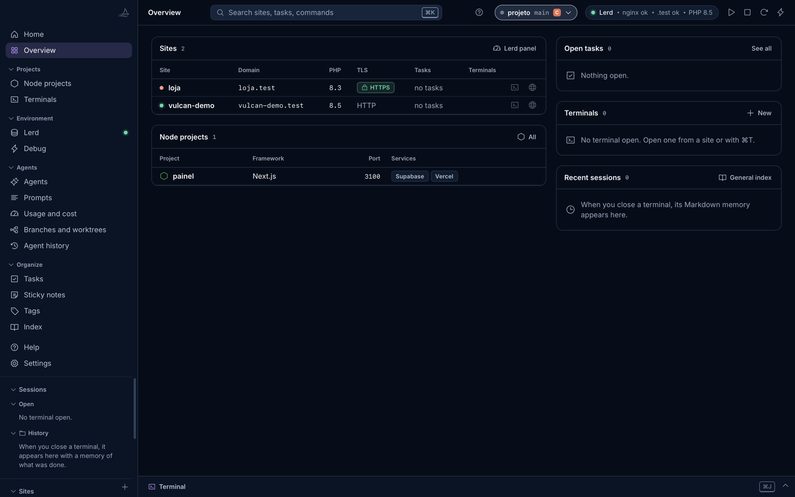
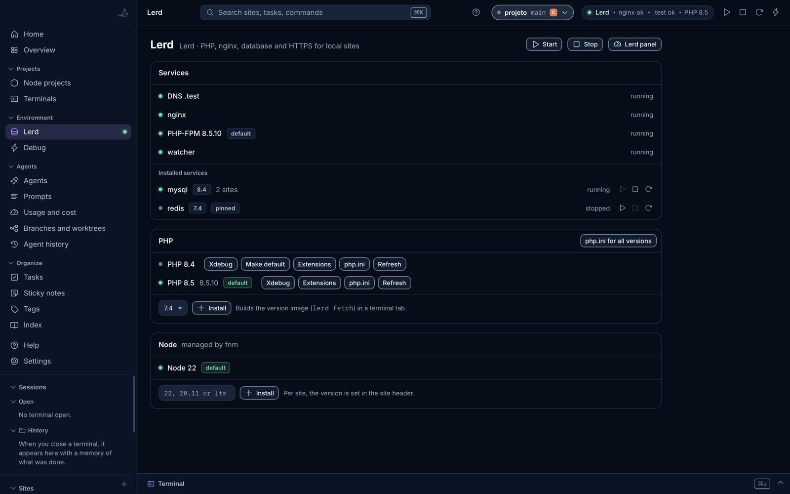
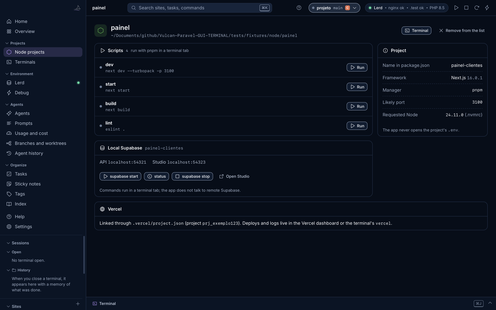
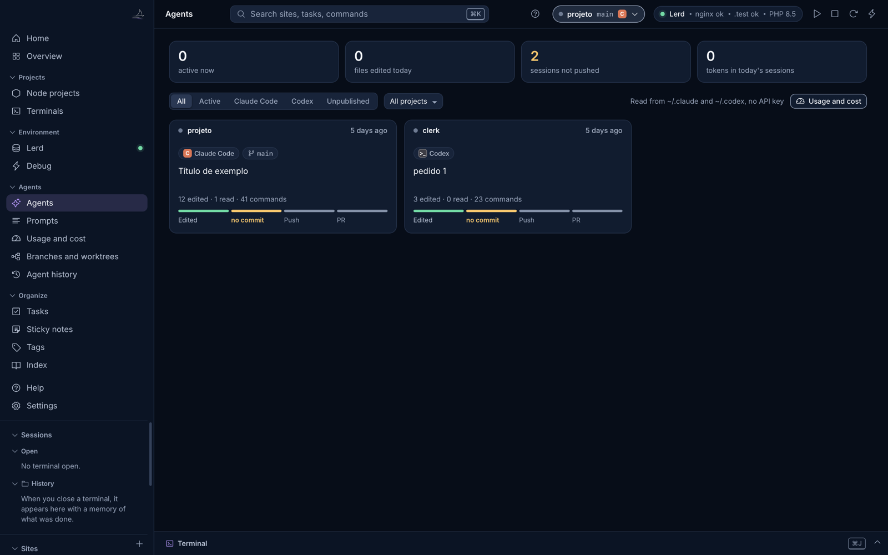
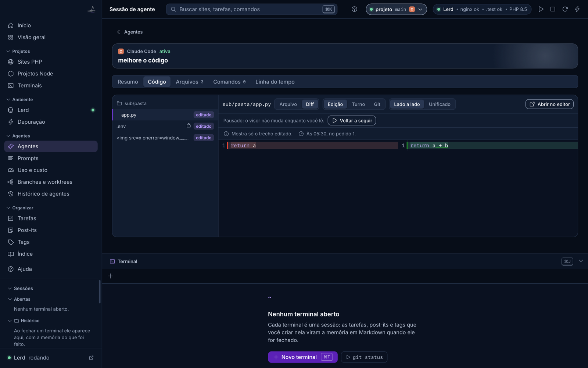
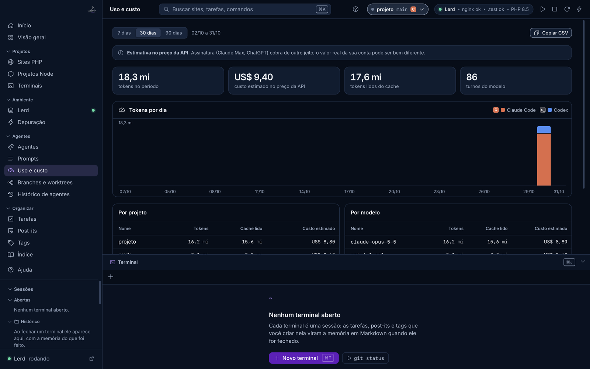
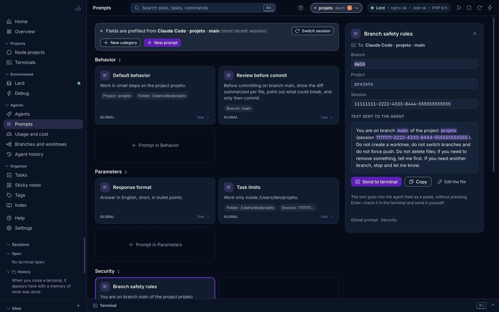
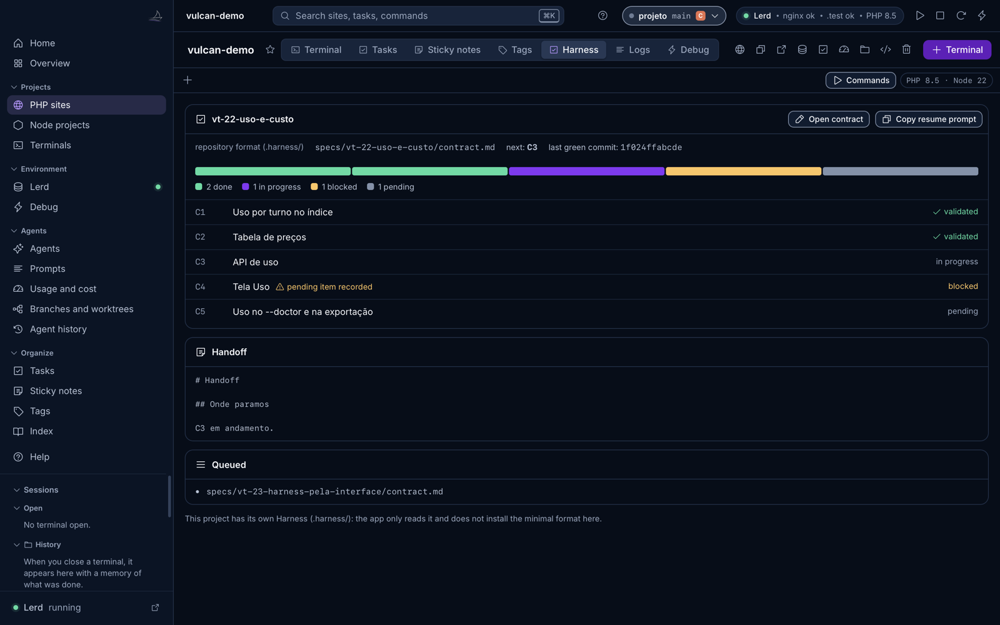

# Vulcan Celox manual

> Generated by `scripts/manual_md.py` from `vulcan_celox/web/help/conteudo.en.json`, the same content as the app's Help screen (⌘?). Do not edit this file by hand.

## Contents

- [Getting started](#primeiros-passos): What Vulcan Celox does and how to start in a few steps.
- [PHP sites](#projetos-php): Lerd sites: open, switch PHP, HTTPS, logs and terminal.
- [Lerd](#lerd): The environment that runs the PHP, nginx, database and HTTPS of your sites.
- [Node projects](#node): Next.js, Vite, local Supabase and Vercel link.
- [Terminals and sessions](#terminais): Tabs, the bottom panel and each session's memory.
- [Debug and logs](#depuracao): Dumps, queries, exceptions and laravel.log.
- [Agents](#agentes): Claude Code and Codex sessions read from disk.
- [Usage and cost](#custo): Tokens and estimated cost by day, project, model and session.
- [Prompts](#prompts): Ready-made instructions you send to the agent with one click.
- [Harness](#harness): Contract, items and handoff that the agents follow.
- [Tasks, sticky notes, tags and index](#organizar): What gets recorded for each project.
- [Keyboard shortcuts](#atalhos): The shortcuts that save the most time.
- [Security and privacy](#seguranca): What the app reads, what it writes and what it never does.
- [Frequently asked questions](#frequently-asked-questions)

## Getting started

*What Vulcan Celox does and how to start in a few steps.*

The app has a light and a dark theme. Press ⌘K, search for "Theme" and pick System, Light or Dark. The terminal area stays dark in both, with each tab's own color.

Vulcan Celox is a panel for solo developers who code with coding agents. It puts in one place the PHP sites that **Lerd** runs on your Mac, your Node projects (Next.js, Vite and the like), the terminals of each project and the **Claude Code** and **Codex** sessions.

1. **Start Lerd.** The green dot at the top right, and on the Lerd item in the sidebar, shows that nginx, `.test` DNS and PHP are responding. Without Lerd, Node projects and agents work the same way.
2. **Find your projects.** Sites registered in Lerd show up on their own. Node projects come in through the + in the Node projects section, or through suggestions taken from the folders where your agents worked.
3. **Let the app read the agent sessions.** It reads the Claude Code and Codex files from disk, line by line, with no API key and without writing anything in those folders.
4. **Open a terminal in a project** with ⌘T. Tasks, sticky notes and tags created there become the session memory in Markdown when the terminal closes.

The **Home** screen checks these steps by itself and stops opening at launch once the essential steps are done. The Lerd step is optional: **Install** shows the official command and runs it in a visible terminal, and **I don't use it** dismisses the step. Check **Don't show the guide again** to make the app open straight on the Overview. The guide stays available in the Home item of the sidebar.

## PHP sites

*Lerd sites: open, switch PHP, HTTPS, logs and terminal.*

Each Lerd site shows up in the Overview and in the Sites section of the sidebar, with its `.test` domain, PHP version and HTTPS. Clicking a site opens its page, with tabs for terminal, tasks, sticky notes, logs, debug and harness.

- **Add a site:** the + in the Sites section links a folder to a domain (`lerd link`) or registers a folder full of projects (`lerd park`). Lerd writes `.php-version` in the folder when it registers it.
- **Switch the site's PHP, HTTPS or Node:** from the site page. Actions that build an image run in a terminal tab, with the output in view.
- **Share:** opens a public tunnel and shows the address when it appears in the output.
- **Remove:** taking a site off the app's list deletes nothing. Deleting the folder sends it to the Trash, never permanently.

The sites belong to Lerd. The app only calls Lerd's own CLI and API and never edits its global files.

## Lerd

*The environment that runs the PHP, nginx, database and HTTPS of your sites.*

**Lerd** is an open source PHP development environment (MIT license). It runs nginx, PHP-FPM, `.test` DNS, databases and HTTPS certificates in containers, so you never configure a web server by hand. Vulcan Celox is the panel on top of it.

- **Lerd item in the sidebar:** the dot shows the state (green running, pink stopped, gray missing). The screen has Start, Stop and Lerd dashboard.
- **Services:** database, Redis and others, with start and stop.
- **PHP:** installed versions, extensions, Xdebug and six common php.ini settings, written by `lerd php:ini` itself.
- **Lerd Node:** versions that Lerd manages for PHP sites with a JavaScript front end.
- **Start with the app:** the lightning button at the top starts Lerd together with Vulcan Celox. It comes off: Lerd is optional and only needed for PHP and Laravel sites.

Laravel Valet also works as an alternative. Herd is commercial and is not used.

## Node projects

*Next.js, Vite, local Supabase and Vercel link.*

Node projects do not use Lerd. The app reads `package.json`, finds the package manager from the lockfile (pnpm, npm, yarn or bun), the framework from the dependencies and the likely port, and shows local Supabase and the Vercel link.

1. Click the + in the **Node projects** section and choose the root folder, where `package.json` lives. Nothing is written to it.
2. On the project page, **Run** opens a terminal tab and types `pnpm run dev` (or the project's package manager). The tab appears in the bottom panel.
3. When the server shows its local address, the **Open in browser** button appears.
4. **Stop** sends Ctrl-C to the project's own tab. The tab stays open with the output.

- **Local Supabase:** with `supabase/config.toml` in the project, the buttons run `supabase start`, `status` and `stop` in a terminal, and Open Studio takes you to the local dashboard.
- **Vercel:** the app only shows whether the folder is linked (`.vercel/project.json`). Deploys and logs stay in the Vercel dashboard or in the `vercel` command in the terminal.
- The app never opens the project's `.env` and does not talk to Vercel or to remote Supabase.

## Terminals and sessions

*Tabs, the bottom panel and each session's memory.*

Each terminal is a session. It opens in the folder you chose, with a color theme that identifies the session, and can start with Claude Code or Codex already running.

- **Ports:** the tab shows the ports its processes opened, such as `:5173 +2`, in the tab bar and in the session list. Clicking opens `http://localhost:<port>` in the browser. Only the tab's own processes count.
- **⌘T** opens a new terminal; **⌘J** shows or hides the bottom terminal panel, which follows you across all screens.
- **Quick commands** for the project (composer, artisan, npm) sit in the terminal bar.
- **Memory:** when a terminal closes, its commands, tasks, sticky notes and tags become a Markdown file, which shows up in Recent sessions and in the Index.
- **Detach:** a tab can become its own window and come back later.

## Debug and logs

*Dumps, queries, exceptions and laravel.log.*

The **Debug** screen (⇧⌘E) shows what arrives through Lerd's dump bridge: `dump()`, queries, logs and exceptions, grouped by request, with a warning for repeated queries. The site's Logs tab reads `storage/logs/laravel.log` by level.

In an agent session, the **Debug during the period** panel shows only what happened while the agent was working, with a summary you can copy, cleaned of secrets first.

## Agents

*Claude Code and Codex sessions read from disk.*

The **Agents** screen lists the Claude Code and Codex sessions on this machine, with project, branch, last request, files touched and state (active, idle, looping). Clicking a session opens its timeline.

- **Who is waiting for you:** the tab gets a ring and the sidebar shows how many sessions finished their turn or may be waiting. The notice clears when you focus the tab or open the session, and ⌘⇧U jumps to the most recent one. "May be waiting" is a guess: the tool may just be slow. Programs that notify through the terminal (OSC 9, 99 and 777, or the bell) also light the ring. With the window unfocused, the app sends a system notification with only the agent, project and state, and shows the count on the Dock icon; to turn it on or off, press ⌘K and search for "System notification".
- **Agent history:** search everything the agents did, by text, file or command.
- **Branches and worktrees:** which branch each agent is working on, so work does not get mixed up.
- **Resume:** opens a terminal in the session's folder with the agent's resume command already typed.
- **Pairing:** the terminal that opened an agent stays linked to its session, so prompts come out filled in. For Codex the link is by folder and time: two sessions opened almost together in the same folder can still swap tabs. Subagents and the Codex desktop app do not link to tabs.

**⌘-click on a path.** In the terminal, with ⌘ held, paths such as `a/b.py`, `/abs/b.py`, `b.py:12` and `b.py(12)` become links, if the file exists inside a known folder. With a paired session it opens in the Code tab, at the line. Without a session it opens in the editor. A folder opens in Finder. A relative path counts from the session's folder or from the folder where the tab opened: after a `cd` it may not be found.

**Navigate by request.** ⌘⇧↑ and ⌘⇧↓ jump between requests. In the terminal, each Enter in a tab with a live agent becomes a mark, without drawing anything on screen. If the agent uses the whole terminal screen, there is no history to navigate, and the app warns you once. In the session, the **Timeline** groups by request, with files and commands, and each edited file leads to the diff of that request.

**PR state.** By default the app estimates it from the session's commands and says so on screen. Turn on "PR state from GitHub" in ⌘K to see number, draft, state and checks through your own `gh`. Only this option uses the network.

**Code tab.** Inside a session, the **Code** tab shows the files the agent touched, marked as new, edited, read or deleted. You see the file with syntax highlighting or the diff: of one edit, of a whole request or against the last commit, side by side or unified. ⌘F searches the file. In an active session the viewer follows the agent, opening each edited file and scrolling to the changed part. Scrolling, clicking or selecting text pauses it, and **Resume following** brings it back. In paired tabs, the **Code** button in the bar above the terminal takes you straight here.

The viewer is read only: nothing is edited in the app. It opens files inside the session folder, up to 1 MB, and does not show binaries or sensitive names such as `.env`, keys and credentials. The edit contents come from the agent's log, so they vanish when the agent deletes the old session.

The app only reads these files, line by line. It never writes to `~/.claude` or `~/.codex`. The only exception is the pairing hook, which you install on purpose with `--instalar-hook` and which keeps a backup.

## Usage and cost

*Tokens and estimated cost by day, project, model and session.*

The **Usage and cost** screen adds up the tokens each agent request used and estimates the cost at each model's public API price, by day, project, model and session. The Copy CSV button takes the numbers to a spreadsheet.

The value is an **estimate at API prices**. Anyone on a subscription plan pays a different amount. A model with no known price shows no cost, never zero. You can change the prices in the `precos.json` file in the app's data folder.

## Prompts

*Ready-made instructions you send to the agent with one click.*

Prompts are instructions you keep sending to the agent: work in small steps, review before the commit, task limits. Each card says what the prompt does and shows the data it uses, such as **Branch: main**, already filled in from the current session.

1. **Click the card.** The composer opens at the side, with a field for each piece of data (project, branch, folder, session) and a preview of the text with the values highlighted.
2. **Check or adjust the fields.** The preview changes as you type. An empty field shows in amber and blocks sending until it is filled.
3. **Click Send to terminal** (or ⌘Enter). The text goes into the agent's input as a paste, **without pressing Enter**: check it in the terminal and send it yourself.
4. **With no paired terminal, or with the agent already closed in that tab,** the text is not pasted, so it never lands in the shell. The composer offers to resume the session in a terminal. Copy stays available to paste elsewhere with ⌘V.

- Global prompts live in the app's data folder; project prompts live in `.vulcan/prompts` inside the project and override a global one with the same id. The paths appear in the New prompt dialog.
- In the file header, `descricao` sets the card text and `icone` the icon. Without `descricao`, the card uses the first sentence of the prompt.
- Pinned prompts (`pin: true`) appear in the terminal bar. In a tab paired with an agent, one click pastes the text, also without Enter.

## Harness

*Contract, items and handoff that the agents follow.*

The harness is the contract with verifiable items, the run state and the handoff that agents read to resume work. Each site's **Harness** tab shows the active contract, the item bar (done, in progress, blocked, pending), the next item and the last green commit.

- **Copy resume prompt:** ready-made text for the agent to continue from the right item.
- **Install harness:** in a project without a harness, creates the minimal format after showing the exact list of files. Nothing is overwritten; in an existing `CLAUDE.md` or `AGENTS.md` only a marked block is added.
- **New contract:** a form that writes `.vulcan/tasks/<id>.md`, always with approval pending until you approve it in the file.

## Tasks, sticky notes, tags and index

*What gets recorded for each project.*

- **Tasks:** per site or global, with a due date and state. Open ones show in the Overview.
- **Sticky notes:** quick notes per site or global.
- **Tags:** mark sessions, tasks and notes so you can find them later.
- **Index:** all session memories in Markdown, with search. AI documentation is optional, only on click, and uses your own Anthropic key stored in the Keychain.

## Keyboard shortcuts

*The shortcuts that save the most time.*

| Shortcut | Action |
|----------|--------|
| `⌘K` | Search sites, projects, tasks and commands |
| `⌘T` | New terminal |
| `⇧⌘T` | New terminal, asking for the folder |
| `⌘J` | Show or hide the terminal panel |
| `⌘⇧U` | Jump to the most recent agent notice |
| `⌘F` | Search in the terminal |
| `⇧⌘P` | Prompts |
| `⇧⌘E` | Debug |
| `⌘1 to ⌘5` | Overview, Terminals, Tasks, Sticky notes and Tags |
| `⌘?` | Help |

## Security and privacy

*What the app reads, what it writes and what it never does.*

- The internal server only listens on `127.0.0.1`, with a token per run. Nothing is exposed on the network.
- Agent sessions: read only, line by line. The app never writes to `~/.claude`, `~/.codex` or their configuration files, except the pairing hook that you install on purpose, with a backup.
- Nothing is deleted permanently: a removed folder goes to the Trash.
- In a project folder, the app writes only with your confirmation and inside a marked block.
- The projects' `.env` is never opened.
- The Anthropic key, if you add one, stays in the Keychain and is used only when you click to document a session.

## Frequently asked questions

**What is Lerd for?**

It is the environment that runs your PHP and Laravel sites on the Mac: `.test` domain, a PHP version per project, database and local HTTPS, without configuring a server by hand. It is optional: terminals, agents and Node projects work without it. Install it from Home if you want it.

**Do I need Lerd to use the app?**

No. Without Lerd or Valet the app opens in local mode: Node projects, terminals, agents, prompts, tasks and notes work. Only the PHP sites part is limited.

**My project is Next.js with Supabase and Vercel. Does the app help?**

Yes. Add the folder under Node projects: the app starts and stops the development server in a terminal you can see, shows the port, runs `supabase start` and `stop` and tells you whether the folder is linked to Vercel.

**Lerd is stopped. How do I start it?**

Click Start on the Lerd screen, or the play button at the top. The first time can take up to a minute, because Lerd brings up the containers. To always start it with the app, use the lightning button.

**I clicked Run and saw nothing.**

The script runs in a tab of the bottom terminal panel. If the panel is hidden, press ⌘J. The tab is named after the project and the script.

**The server says the port is already in use.**

Another process is using the same port, often an old `dev` left running. Stop the script from the project page or close the old tab. The app does not kill processes by port: it only sends Ctrl-C to the project's own tabs.

**Does the app write to the Claude Code or Codex folders?**

No. It only reads the sessions, line by line. The only exception is the pairing hook, which you install on purpose with `--instalar-hook` and which keeps a backup of the original file.

**Is the cost shown what I paid?**

No. It is an estimate at each model's public API price. Anyone on a subscription plan pays a different amount. A model with no price shows no cost, never zero.

**How do I change a model's price?**

Edit `precos.json` in the app's data folder (`~/Library/Application Support/VulcanCelox/`). The value in the file wins over the built-in table.

**An agent does not show up in the list.**

The app reads Claude Code and Codex. Compressed Codex sessions (`.jsonl.zst`) are read when the `zstd` command is installed; without it they are left out and `--doctor` counts how many. Gemini and Cursor are not among the agents read for now.

**Why does a prompt field show in amber?**

That piece of data is missing from the current session, for example the branch. Fill in the field in the composer or pick another session under Switch session. While any field is empty, Send to terminal stays blocked.

**Where are the prompts stored?**

As `.md` files: global ones in the app's data folder and project ones in `.vulcan/prompts` inside the project. The exact paths appear in the New prompt dialog.

**What happens when I close a terminal?**

Its commands, tasks, sticky notes and tags become a Markdown memory file. It shows up in Recent sessions, in the Overview, and in the Index.

**I removed a site by mistake. Did I lose the folder?**

No. Taking it off the list deletes nothing. Even when you ask to delete the folder, it goes to the Mac's Trash and can be restored.

**What is the harness?**

It is the contract the agents follow: items with a sensor, run state and handoff. The Harness tab shows which item the work is on and what is blocked.

**Does installing the harness touch my files?**

Only with your confirmation, and after showing the exact list. An existing file is never overwritten; in `CLAUDE.md` or `AGENTS.md` only a marked block is added, which can be replaced later.

**How do I see the Home guide again?**

Click Home in the sidebar. To make it open with the app again, uncheck Don't show the guide again.

**I opened it in the browser and it asks for a token.**

The interface needs the token that the native app creates on each run. Open it through Vulcan Celox, from the desktop shortcut or from Applications.

**Does the prompt sent to the terminal run already?**

No. The text goes into the agent's input as a paste and nothing is sent by itself. You review it in the terminal and press Enter.
