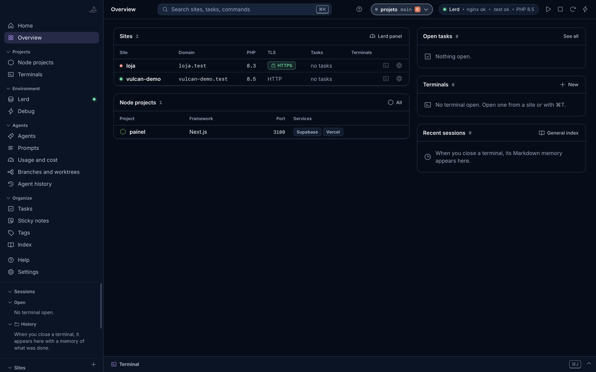
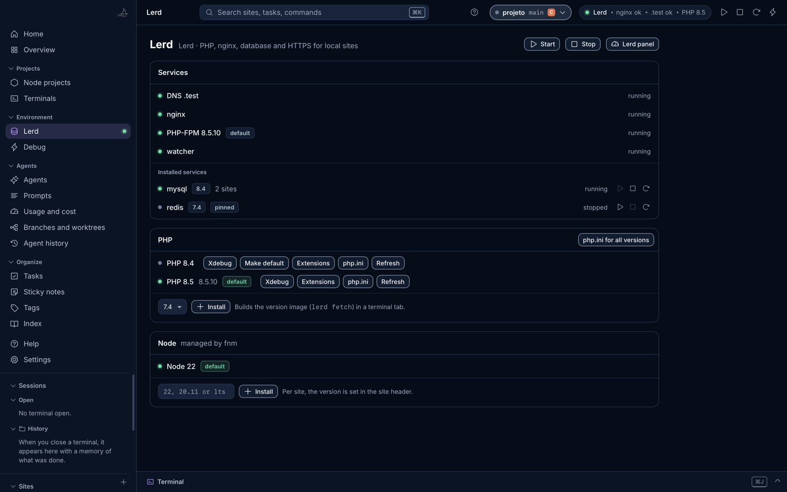
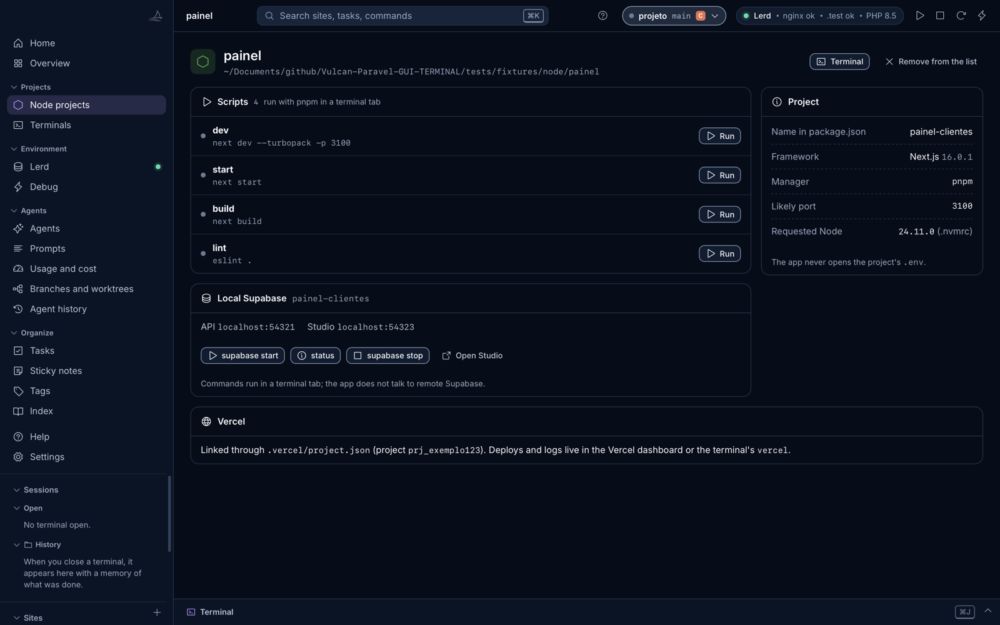
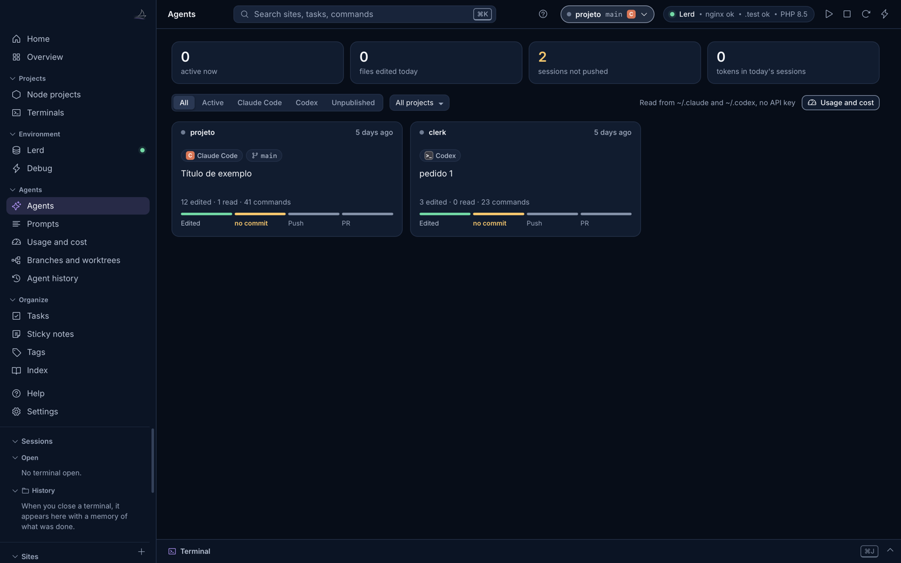
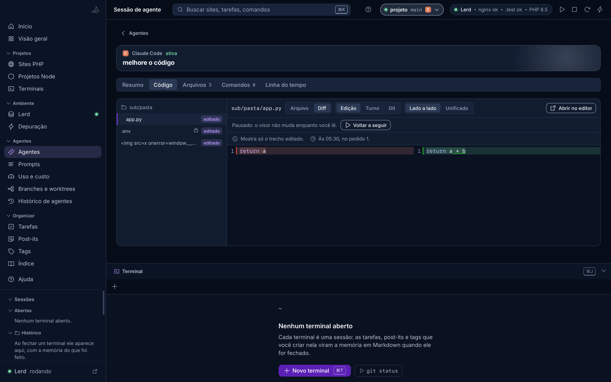
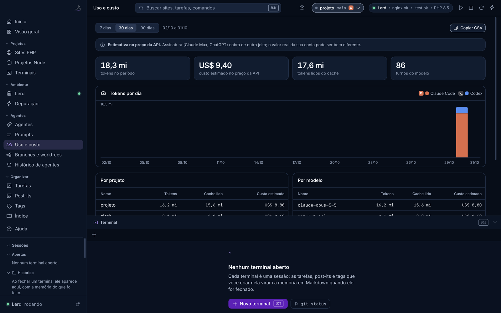
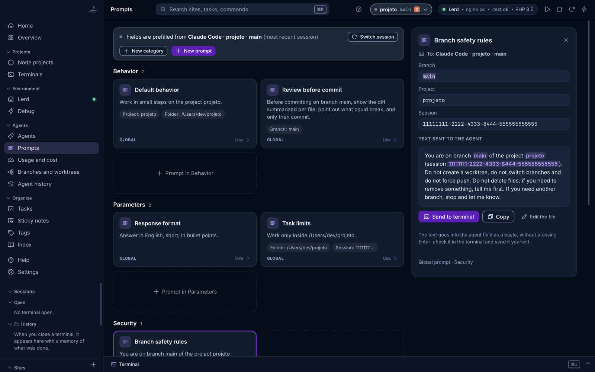
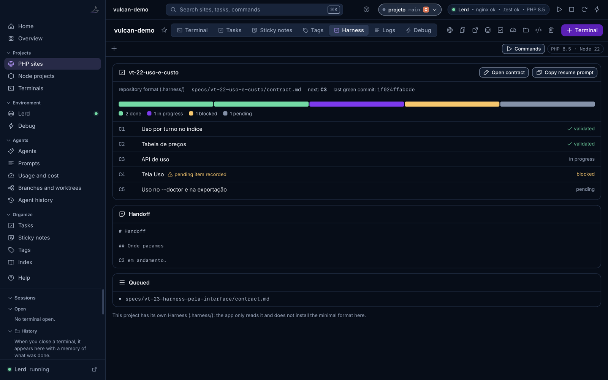

# Manual de Vulcan Celox

> Generado por `scripts/manual_md.py` a partir de `vulcan_celox/web/help/conteudo.es.json`, el mismo contenido de la Ayuda de la aplicación (⌘?). No edites este archivo a mano.

## Contenido

- [Primeros pasos](#primeiros-passos): Qué hace Vulcan Celox y cómo empezar en pocos pasos.
- [Sitios PHP](#projetos-php): Sitios de Lerd: abrir, cambiar PHP, HTTPS, registros y terminal.
- [Lerd](#lerd): El entorno que ejecuta PHP, nginx, bases de datos y HTTPS para tus sitios.
- [Proyectos Node](#node): Next.js, Vite, Supabase local y vínculo con Vercel.
- [Código](#codigo): Todo el árbol de un proyecto y lo que se escribe en disco, en directo.
- [Terminales y sesiones](#terminais): Pestañas, panel inferior y memoria de cada sesión.
- [Depuración y registros](#depuracao): Dumps, consultas, excepciones y laravel.log.
- [Agentes](#agentes): Sesiones de Claude Code y Codex leídas del disco.
- [Uso y coste](#custo): Tokens y coste estimado por día, proyecto, modelo y sesión.
- [Prompts](#prompts): Instrucciones preparadas que envías al agente con un clic.
- [Harness](#harness): Contrato, elementos y relevo que siguen los agentes.
- [Tareas, notas adhesivas, etiquetas e índice](#organizar): Qué se registra para cada proyecto.
- [Configuración](#configuracoes): Qué muestra la barra lateral y los ajustes de la aplicación, en una sola pantalla.
- [Atajos de teclado](#atalhos): Los atajos que más tiempo ahorran.
- [Seguridad y privacidad](#seguranca): Qué lee la aplicación, qué escribe y qué no hace nunca.
- [Preguntas frecuentes](#preguntas-frecuentes)

## Primeros pasos

*Qué hace Vulcan Celox y cómo empezar en pocos pasos.*

La aplicación tiene un tema claro y uno oscuro: elige en **Configuración**, dentro de Apariencia. El área del terminal permanece oscura en ambos, con el color propio de cada pestaña.

Vulcan Celox es un panel para quienes desarrollan en solitario con agentes de programación. Reúne en un solo lugar los sitios PHP que **Lerd** ejecuta en tu Mac, tus proyectos Node (Next.js, Vite y similares), los terminales de cada proyecto y las sesiones de **Claude Code** y **Codex**.

1. **Inicia Lerd.** El punto verde de la esquina superior derecha y del elemento Lerd de la barra lateral indica que nginx está en ejecución. El texto de al lado muestra el DNS `.test` y la versión de PHP. Sin Lerd, los proyectos Node y los agentes funcionan igual.
2. **Encuentra tus proyectos.** Los sitios registrados en Lerd aparecen automáticamente. Los proyectos Node se añaden mediante el + de la sección Proyectos Node o desde las sugerencias tomadas de las carpetas donde han trabajado tus agentes.
3. **Deja que la aplicación lea las sesiones de agentes.** Lee los archivos de Claude Code y Codex del disco, línea a línea, sin clave de API y sin escribir nada en esas carpetas.
4. **Abre un terminal en un proyecto** con ⌘T. Sus comandos, tareas, notas adhesivas, etiquetas y salida reciente se conservan como memoria de la sesión en Markdown.

La pantalla **Inicio** se abre con la aplicación: comprueba estos pasos automáticamente y explica en tarjetas qué hace cada elemento. El paso de Lerd es opcional: **Instalar** muestra el comando oficial y lo ejecuta en un terminal visible, mientras que **No lo uso** descarta el paso. Marca **No mostrar esta pantalla al iniciar** para que la aplicación deje de abrirla al arrancar. Sigue disponible en Inicio, en la barra lateral, y puedes volver a activarla en Configuración.

## Sitios PHP

*Sitios de Lerd: abrir, cambiar PHP, HTTPS, registros y terminal.*

Cada sitio de Lerd aparece en Vista general y en la sección Sitios de la barra lateral con su dominio `.test`, versión de PHP y HTTPS. Al pulsar un sitio se abre su página, con pestañas para terminal, tareas, notas adhesivas, registros, depuración y harness.

- **Añadir un sitio:** el + de la sección Sitios vincula una carpeta a un dominio (`lerd link`) o registra una carpeta que contiene proyectos (`lerd park`). Lerd escribe `.php-version` en la carpeta cuando la registra.
- **Cambiar PHP, HTTPS o Node del sitio:** desde la página del sitio. Las acciones que construyen una imagen se ejecutan en una pestaña de terminal, con la salida a la vista.
- **Compartir:** abre un túnel público y muestra la dirección cuando aparece en la salida.
- **Eliminar:** da de baja el sitio en Lerd para que deje de servirse. La carpeta permanece intacta salvo que elijas enviarla a la Papelera.

Los sitios pertenecen a Lerd. La aplicación solo llama a la CLI y a la API del propio Lerd y nunca edita sus archivos globales.

## Lerd

*El entorno que ejecuta PHP, nginx, bases de datos y HTTPS para tus sitios.*

**Lerd** es un entorno de desarrollo PHP de código abierto (licencia MIT). Ejecuta nginx, PHP-FPM, el DNS `.test`, bases de datos y certificados HTTPS en contenedores, para que no tengas que configurar un servidor web a mano. Vulcan Celox es el panel que se apoya en él.

- **Lerd en la barra lateral:** el punto indica el estado (verde: en ejecución, rosa: detenido, gris: ausente). La pantalla incluye Iniciar, Detener y Panel de Lerd.
- **Servicios:** bases de datos, Redis y otros, con controles para iniciar y detener.
- **PHP:** versiones instaladas, extensiones, Xdebug y seis ajustes habituales de php.ini, escritos por el propio `lerd php:ini`.
- **Node de Lerd:** versiones que Lerd gestiona para sitios PHP con una interfaz JavaScript.
- **Iniciar con la aplicación:** el botón del rayo de la parte superior inicia Lerd junto con Vulcan Celox. Viene desactivado: Lerd es opcional y solo se necesita para sitios PHP y Laravel.

Laravel Valet también sirve como alternativa. Herd es comercial y no se utiliza.

## Proyectos Node

*Next.js, Vite, Supabase local y vínculo con Vercel.*

Los proyectos Node no utilizan Lerd. La aplicación lee `package.json`, identifica el gestor de paquetes por el archivo de bloqueo (pnpm, npm, yarn o bun), el framework por las dependencias y el puerto probable, y muestra Supabase local y el vínculo con Vercel.

1. Pulsa el + de la sección **Proyectos Node** y elige la carpeta raíz, donde está `package.json`. No se escribe nada en ella.
2. En la página del proyecto, **Ejecutar** abre una pestaña de terminal y escribe `pnpm run dev` (o el gestor de paquetes del proyecto). La pestaña aparece en el panel inferior.
3. Cuando el servidor muestra su dirección local, aparece el botón **Abrir en el navegador**.
4. **Parar** envía Ctrl-C a la pestaña del propio proyecto. La pestaña permanece abierta con la salida.

- **Supabase local:** si el proyecto tiene `supabase/config.toml`, los botones ejecutan `supabase start`, `status` y `stop` en un terminal, y Abrir Studio lleva al panel local.
- **Vercel:** la aplicación solo muestra si la carpeta está vinculada (`.vercel/project.json`). Los despliegues y registros permanecen en el panel de Vercel o en el comando `vercel` del terminal.
- La aplicación nunca abre el `.env` del proyecto ni se comunica con Vercel ni con Supabase remoto.

## Código

*Todo el árbol de un proyecto y lo que se escribe en disco, en directo.*

La pantalla **Código** muestra todo el árbol de una carpeta y sigue lo que se escribe en disco, tanto por un agente como por cualquier otro programa, sin necesidad de una sesión. Es de solo lectura: nada de aquí escribe en el proyecto. La pestaña Código de una sesión de agente sigue existiendo y muestra solo lo que ha tocado esa sesión.

1. Ábrela desde la barra lateral o mediante el botón **Abrir en Código** de un sitio, proyecto Node o sesión. Los sitios, proyectos Node y carpetas de sesiones aparecen automáticamente en la lista; **Abrir carpeta** añade otra.
2. Pulsa un archivo o usa las flechas e Intro. Se mantienen abiertas hasta 12 pestañas y cada carpeta recuerda las suyas.
3. Deja **Siguiendo** activado para que el visor vaya al archivo que acaba de cambiar. Cualquier gesto en el árbol o en el visor pausa el seguimiento; un clic en el botón lo reanuda y va al último cambio.

- **Marcas:** A, M y D indican qué se ha añadido, modificado o eliminado desde que se abrió la pantalla, en comparación con una instantánea del disco. Una carpeta contraída con cambios dentro recibe un punto. Los archivos eliminados permanecen a la vista con un aviso.
- **Quién ha escrito:** el punto de color y la barra inferior solo identifican al agente cuando la sesión de esa carpeta ha registrado la misma edición en un plazo de 60 s. Sin ese registro aparece **Cambio en disco**. El registro puede llegar algo después de la escritura y la marca se actualiza.
- **Diff contra Git:** compara con el último commit.
- **Marcas de Git:** en una carpeta con Git, cada archivo muestra **M** (modificado desde el último commit), **U** (nuevo, fuera de Git) o **D** (eliminado del disco, aún en Git, tachado). Una carpeta contraída recibe un punto si contiene marcas y la rama aparece encima del árbol. Las marcas en directo se superponen. La aplicación lee el índice de Git y compara el tamaño y la fecha con el disco, sin ejecutar `git status`: un archivo que solo se haya tocado también aparece como **M**.
- **Ir a archivo** (⌘P o Ctrl+Shift+P fuera del Mac) filtra por nombre. La lupa busca texto en los archivos de Git; sin Git, la pantalla indica que la búsqueda lo necesita.
- **Restricciones:** no se abren toda la carpeta personal, la raíz del disco ni las carpetas de datos de la aplicación o de los agentes. `.env`, claves y credenciales aparecen en el árbol, pero su contenido no se muestra. Tampoco se abren archivos de más de 1 MB, binarios ni enlaces que salgan de la carpeta.
- **Límites:** los cambios en carpetas ignoradas solo aparecen si la carpeta está abierta. A partir de 20 mil elementos, solo se vigilan las carpetas abiertas y el archivo abierto, y la barra inferior lo indica. En un sistema de archivos de red, la fecha de modificación puede no ser fiable.

## Terminales y sesiones

*Pestañas, panel inferior y memoria de cada sesión.*

Cada terminal es una sesión. Se abre en la carpeta elegida, con un tema de color que identifica la sesión. En el diálogo de nuevo terminal, elige Claude Code, Codex o solo el shell para esa pestaña: la elección no pasa a las siguientes. Cada diálogo empieza con el shell seleccionado. Si desactivas la pregunta de carpeta, las nuevas pestañas se abren directamente en el shell; ⇧⌘T vuelve a mostrar el diálogo.

- **Terminales en la barra lateral:** la lista reúne los PTY activos. Usa el nombre para enfocar una pestaña y el botón contiguo para editar su nombre y color. Abre **Historial** para consultar las sesiones finalizadas.
- **Código de la sesión:** ábrelo desde una pestaña de terminal global o de un sitio. **Archivos** muestra el árbol y los cambios guardados desde la apertura. Usa **Archivo** para leer el texto completo o consulta el diff contra HEAD. La lectura manual pausa los saltos automáticos.
- **Codex:** escribe un borrador y elige y confirma la pestaña de destino. Usa **Copiar prompt** y **Abrir terminal**. Comprueba que el campo de Codex está en primer plano, pega y pulsa Intro en la CLI. **Borradores de esta ventana** conserva el texto hasta cerrar o recargar la ventana.
- **Nombre y color:** selecciona una pestaña y usa Nombre y color para identificarla. El color de la pestaña es independiente de la paleta del shell.
- **Puertos:** la pestaña muestra los puertos abiertos por sus procesos, como `:5173 +2`, en la barra de pestañas y en la lista de sesiones. Al pulsarlos se abre `http://localhost:<port>` en el navegador. Solo se cuentan los procesos de esa pestaña.
- **⌘T** abre un terminal nuevo; **⌘J** muestra u oculta el panel inferior de terminal en las pantallas que no muestran ya un terminal.
- Los **comandos rápidos** del proyecto (composer, artisan, npm) están en la barra del terminal.
- **Memoria:** mientras un terminal está abierto, la aplicación mantiene un archivo Markdown con los comandos escritos, las tareas, las notas adhesivas, las etiquetas y las últimas 2.000 líneas de salida. Las contraseñas y claves que reconoce se guardan como `[secreto]` (`[secret]` en inglés y `[segredo]` en portugués), y lo que escribes en una petición de contraseña oculta no se registra. El reconocimiento se basa en patrones, de modo que un secreto poco habitual puede pasar inadvertido; en Windows no se puede detectar la petición oculta. Cuando se cierra el terminal, el archivo aparece en Sesiones recientes y en Índice.
- **Separar:** una pestaña puede convertirse en una ventana independiente y volver después.

## Depuración y registros

*Dumps, consultas, excepciones y laravel.log.*

La pantalla **Depuración** (⇧⌘E) muestra lo que llega por el puente de dumps de Lerd: `dump()`, consultas, registros y excepciones, agrupados por petición, con avisos de consultas repetidas. La pestaña Registros del sitio lee `storage/logs/laravel.log` por nivel.

En una sesión de agente, el panel **Depuración durante el periodo** muestra solo lo ocurrido mientras el agente trabajaba, con un resumen que puedes copiar y al que se le ocultan los secretos previamente.

## Agentes

*Sesiones de Claude Code y Codex leídas del disco.*

La pantalla **Agentes** muestra las sesiones de Claude Code y Codex de este equipo, con proyecto, rama, título o primera petición, archivos tocados y estado (activa, inactiva, en bucle). Al pulsar una sesión se abre su resumen, con las pestañas Código, Archivos, Comandos y Cronología.

- **Quién espera tu respuesta:** la pestaña recibe un anillo y la barra lateral muestra cuántas sesiones han terminado su turno o podrían estar esperando. El aviso desaparece al enfocar la pestaña o abrir la sesión, y ⌘⇧U salta a la más reciente. «Quizá esté esperando» es una suposición: la herramienta puede estar tardando. Los programas que avisan por el terminal (OSC 9, 99 y 777, o el timbre) también encienden el anillo. Con la ventana en segundo plano, la aplicación envía una notificación del sistema que contiene solo agente, proyecto y estado, y muestra el número en el icono del Dock; para activarla o desactivarla, pulsa ⌘K y busca «Aviso del sistema».
- **Historial de agentes:** busca todo lo que han hecho los agentes, por texto, archivo o comando.
- **Ramas y worktrees:** en qué rama trabaja cada agente, para no mezclar el trabajo.
- **Reanudar:** abre un terminal en la carpeta de la sesión y ejecuta el comando de reanudación del agente.
- **Vinculación:** el terminal que abre un agente queda vinculado a su sesión para que los prompts se rellenen automáticamente. En Codex, el vínculo se basa en carpeta y hora: dos sesiones abiertas casi a la vez en la misma carpeta aún pueden intercambiar pestañas. Los subagentes y la aplicación de escritorio de Codex no se vinculan a pestañas.

**⌘-clic en una ruta.** En el terminal, al mantener ⌘ pulsado, rutas como `a/b.py`, `/abs/b.py`, `b.py:12` y `b.py(12)` se convierten en enlaces si el archivo existe dentro de una carpeta conocida. Con una sesión vinculada se abre en la pestaña Código, en la línea indicada. Sin sesión se abre en el editor. Las carpetas se abren en Finder. Las rutas relativas parten de la carpeta de la sesión o de aquella donde se abrió la pestaña: después de un `cd`, es posible que no se encuentren.

**Navegar por petición.** ⌘⇧↑ y ⌘⇧↓ saltan entre peticiones. En el terminal, cada Intro en una pestaña con un agente vivo genera una marca, sin dibujar nada en pantalla. Si el agente utiliza toda la pantalla del terminal, no hay historial por el que navegar y la aplicación avisa una vez. En la sesión, la **Cronología** agrupa por petición, con archivos y comandos, y cada archivo editado lleva al diff de esa petición.

**Estado del PR.** Por defecto, la aplicación lo estima según los comandos de la sesión y lo indica en pantalla. Activa «Consultar el estado del PR en GitHub» en Configuración para ver número, borrador, estado y comprobaciones mediante tu propio `gh`. Esta opción usa la red solo para esa consulta.

**Pestaña Código.** Dentro de una sesión, la pestaña **Código** muestra los archivos que ha tocado el agente, marcados como nuevos, editados, leídos o eliminados. Puedes ver el archivo con resaltado de sintaxis o el diff: de una edición, de toda una petición o frente al último commit, en paralelo o unificado. ⌘F busca en el archivo. En una sesión activa, el visor sigue al agente, abre cada archivo editado y se desplaza a la parte modificada. Desplazarse, hacer clic o seleccionar texto lo pausa, y **Reanudar seguimiento** lo activa de nuevo. En pestañas vinculadas, el botón **Código** de la barra sobre el terminal te lleva directamente aquí.

El visor es de solo lectura: no se edita nada desde la aplicación. Abre archivos dentro de la carpeta de la sesión, de hasta 1 MB, y no muestra binarios ni nombres sensibles como `.env`, claves o credenciales. El contenido de las ediciones procede del registro del agente, por lo que desaparece cuando el agente elimina la sesión antigua.

La aplicación solo lee estos archivos, línea a línea. Nunca escribe en `~/.claude` ni en `~/.codex`. La única excepción son los hooks de vinculación y atención, que instalas expresamente con `--instalar-hook`, modificando `~/.claude/settings.json` con una copia de seguridad.

## Uso y coste

*Tokens y coste estimado por día, proyecto, modelo y sesión.*

La pantalla **Uso y coste** suma los tokens utilizados por cada petición al agente y estima el coste según el precio público de la API de cada modelo, por día, proyecto, modelo y sesión. El botón Copiar CSV lleva los números a una hoja de cálculo.

El valor es una **estimación según los precios de la API**. Quien tiene una suscripción paga un importe diferente. Un modelo sin precio conocido no muestra coste, nunca cero. Puedes cambiar los precios en el archivo `precos.json` de la carpeta de datos de la aplicación.

## Prompts

*Instrucciones preparadas que envías al agente con un clic.*

Los prompts son instrucciones que envías repetidamente al agente: trabajar en pasos pequeños, revisar antes del commit, limitar las tareas. Cada tarjeta indica qué hace el prompt y muestra los datos que utiliza, como **Rama: main**, ya rellenados a partir de la sesión actual.

1. **Pulsa la tarjeta.** El compositor se abre al lado, con un campo para cada dato (proyecto, rama, carpeta, sesión) y una vista previa del texto con los valores resaltados.
2. **Revisa o ajusta los campos.** La vista previa cambia mientras escribes. Un campo vacío se muestra en ámbar y bloquea el envío hasta que lo rellenes.
3. **Pulsa Enviar al terminal** (o ⌘Enter). El texto llega a la entrada del agente como texto pegado, **sin pulsar Intro**: revísalo en el terminal y envíalo tú.
4. **Si no hay un terminal vinculado o el agente ya se ha cerrado en esa pestaña,** el texto no se pega, para que nunca termine en el shell. El compositor ofrece reanudar la sesión en un terminal. Copiar sigue disponible para pegar en otro lugar con ⌘V.

- Los prompts globales están en la carpeta de datos de la aplicación; los del proyecto, en `.vulcan/prompts` dentro del proyecto, y tienen prioridad sobre uno global con el mismo id. Las rutas aparecen en el diálogo Nuevo prompt.
- En la cabecera del archivo, `descricao` define el texto de la tarjeta e `icone`, el icono. Sin `descricao`, la tarjeta utiliza la primera frase del prompt.
- Los prompts fijados (`pin: true`) aparecen en la barra del terminal. En una pestaña vinculada a un agente, un clic pega el texto, también sin Intro.

## Harness

*Contrato, elementos y relevo que siguen los agentes.*

El harness reúne el contrato con elementos verificables, el estado de ejecución y el documento de relevo que leen los agentes para reanudar el trabajo. La pestaña **Harness** de cada sitio muestra el contrato activo, la barra de elementos (completado, en curso, bloqueado, pendiente), el siguiente elemento y el último commit validado.

- **Copiar prompt para reanudar:** texto preparado para que el agente continúe desde el elemento correcto.
- **Instalar harness:** en un proyecto sin harness, crea el formato mínimo tras mostrar la lista exacta de archivos. No se sobrescribe nada; en un `CLAUDE.md` o `AGENTS.md` existente solo se añade un bloque marcado.
- **Nuevo contrato:** un formulario que escribe `.vulcan/tasks/<id>.md`, siempre con aprobación pendiente hasta que lo apruebes en el archivo.

## Tareas, notas adhesivas, etiquetas e índice

*Qué se registra para cada proyecto.*

- **Tareas:** por sitio o globales, con fecha de vencimiento y estado. Las pendientes aparecen en Vista general.
- **Notas adhesivas:** haz clic en una nota para editarla en una ventana. Usa **Ir al terminal** para volver a la pestaña vinculada o **Ver en el historial** si la sesión ha terminado. Puedes vincular una nota sin terminal a uno abierto del mismo ámbito.
- **Etiquetas:** marca sesiones, tareas y notas para encontrarlas después.
- **Índice:** una lista Markdown de todas las sesiones; cada entrada abre la memoria de esa sesión. La documentación con IA es opcional, solo se genera al pulsar y utiliza tu propia clave de Anthropic, añadida en Configuración y guardada en el almacén de contraseñas del sistema.

## Configuración

*Qué muestra la barra lateral y los ajustes de la aplicación, en una sola pantalla.*

- **Barra lateral:** marca lo que quieras ver. Incluye los elementos del menú y las listas inferiores (Sesiones, Sitios y Proyectos Node). Lo que ocultes sigue en la búsqueda (⌘K) y **Mostrar todo** lo restaura. Configuración no se puede ocultar, para que siempre puedas volver.
- **Barra lateral contraída:** el botón superior o ⌘B deja solo los iconos en una franja estrecha; pasa el cursor para ver el nombre. Sesiones, Sitios y Proyectos Node se convierten en un icono cada uno que abre su lista en un menú. La elección se conserva; si aún no has elegido, una ventana de menos de 1000 px se abre con la barra contraída.
- **Apariencia:** tema (Sistema, Claro u Oscuro) e idioma: Português (Brasil), English (US) o Español (España). Cambia en Configuración o mediante la búsqueda ⌘K. La interfaz y los menús de macOS siguen tu elección sin cerrar los terminales; el contenido que hayas creado permanece intacto.
- **Al iniciar:** mostrar o no la pantalla de inicio, iniciar Lerd con la aplicación y preguntar la carpeta al abrir un terminal.
- **Avisos y red:** notificación cuando un agente espera tu respuesta, consulta del estado del PR en GitHub (desactivada por defecto) y aviso de versión nueva (activado por defecto, como máximo una vez al día, solo lee el número de versión). Puedes desactivar cada uno.
- **Copias de seguridad y secretos:** **Crear copia de seguridad** guarda todos los datos de la aplicación en un .zip fuera de la carpeta de datos. Incluye tareas, notas adhesivas, etiquetas, memorias, prompts, preferencias e índice de agentes, pero no la clave de Anthropic, que permanece en el sistema. El archivo no está cifrado. **Comprobar** lee el .zip sin extraer nada y muestra fecha, versión, tamaño y cuántos elementos de cada tipo contiene; solo entonces aparece **Restaurar**, nunca para un archivo con errores. La sustitución se realiza al volver a abrir la aplicación y los datos actuales se conservan en `.restauros`. **Copias de restauración** muestra esas carpetas y permite enviar cada una a la Papelera. **Ocultar secretos** reescribe las memorias guardadas antes de que existiera esta función y no se puede deshacer.
- **Clave de Anthropic:** solo se utiliza cuando solicitas documentación con IA.
- **Acerca de:** versión instalada, si hay una más reciente y la carpeta con tus datos. La aplicación nunca descarga ni instala nada por su cuenta: el botón abre la página de la versión.

## Atajos de teclado

*Los atajos que más tiempo ahorran.*

| Atajo | Acción |
|-------|--------|
| `⌘K` | Buscar sitios PHP, tareas, notas adhesivas, etiquetas y comandos |
| `⌘T` | Nuevo terminal |
| `⇧⌘T` | Nuevo terminal, preguntando la carpeta |
| `⌘J` | Mostrar u ocultar el panel de terminal |
| `⌘B` | Contraer la barra lateral en una franja de iconos o volver a abrirla |
| `⌘⇧U` | Ir al aviso de agente más reciente |
| `⌘F` | Buscar en el terminal |
| `⇧⌘P` | Prompts |
| `⇧⌘E` | Depuración |
| `⌘1 a ⌘5` | Vista general, Terminales, Tareas, Notas adhesivas y Etiquetas |
| `⌘P` | Ir a un archivo en la pantalla Código |
| `⌘?` | Ayuda |

## Seguridad y privacidad

*Qué lee la aplicación, qué escribe y qué no hace nunca.*

- El servidor interno solo escucha en `127.0.0.1`, con un token por ejecución. No se expone nada a la red.
- Sesiones de agentes: solo lectura, línea a línea. La aplicación nunca escribe en `~/.claude`, `~/.codex` ni en sus archivos de configuración, salvo el hook de vinculación que instalas expresamente, con una copia de seguridad.
- Las carpetas y los archivos de memoria de sesiones van a la Papelera. Las tareas, notas adhesivas y etiquetas se eliminan de la aplicación; solo se puede deshacer la última tarea eliminada.
- En una carpeta de proyecto, la aplicación solo escribe cuando lo solicitas: archivos nuevos de harness, contratos y prompts, sin sobrescribir nunca, y un bloque marcado en un `CLAUDE.md` o `AGENTS.md` existente. La memoria del terminal permanece en la carpeta de datos de la aplicación, con los secretos reconocidos ocultos al guardar; la documentación con IA solo envía ese texto con los secretos ocultos a Anthropic.
- Nunca se abre el `.env` de los proyectos.
- La clave de Anthropic, si la añades, permanece en el almacén de contraseñas del sistema (el Llavero en macOS) y solo se utiliza cuando pulsas para documentar una sesión.

## Preguntas frecuentes

**¿Para qué sirve Lerd?**

Es el entorno que ejecuta tus sitios PHP y Laravel en este equipo: dominio `.test`, una versión de PHP por proyecto, base de datos y HTTPS local, sin configurar un servidor a mano. Es opcional: los terminales, los agentes y los proyectos Node funcionan sin él. Instálalo desde Inicio si lo necesitas (macOS y Linux).

**¿Necesito Lerd para usar la aplicación?**

No. Sin Lerd ni Valet, la aplicación se abre en modo local: funcionan los proyectos Node, los terminales, los agentes, los prompts, las tareas y las notas. Solo se limita la parte de sitios PHP.

**Mi proyecto usa Next.js con Supabase y Vercel. ¿Me ayuda la aplicación?**

Sí. Añade la carpeta en Proyectos Node: la aplicación inicia y detiene el servidor de desarrollo en un terminal visible, muestra el puerto, ejecuta `supabase start` y `stop` e indica si la carpeta está vinculada a Vercel.

**Lerd está detenido. ¿Cómo lo inicio?**

Pulsa Iniciar en la pantalla Lerd o el botón de reproducción superior. El primer arranque puede tardar varios minutos si Lerd necesita descargar imágenes. Para iniciarlo siempre con la aplicación, usa el botón del rayo.

**He pulsado Ejecutar y no he visto nada.**

El script se ejecuta en una pestaña del panel inferior de terminal. Si el panel está oculto, pulsa ⌘J. La pestaña lleva el nombre del proyecto y del script.

**El servidor indica que el puerto ya está en uso.**

Otro proceso utiliza el mismo puerto, a menudo un `dev` antiguo que sigue en ejecución. Detén el script desde la página del proyecto o cierra la pestaña antigua. La aplicación no termina procesos por puerto: solo envía Ctrl-C a las pestañas del propio proyecto.

**¿La aplicación escribe en las carpetas de Claude Code o Codex?**

No. Solo lee las sesiones, línea a línea. La única excepción son los hooks de vinculación y atención, que instalas expresamente con `--instalar-hook`, conservando una copia de seguridad del archivo original.

**¿El coste mostrado es lo que he pagado?**

No. Es una estimación según el precio público de la API de cada modelo. Quien tiene una suscripción paga un importe diferente. Un modelo sin precio no muestra coste, nunca cero.

**¿Cómo cambio el precio de un modelo?**

Edita `precos.json` en la carpeta de datos de la aplicación (Configuración, en Acerca de, indica dónde está). El valor del archivo tiene prioridad sobre la tabla incorporada.

**No aparece un agente en la lista.**

La aplicación lee Claude Code y Codex. Las sesiones comprimidas de Codex (`.jsonl.zst`) se leen cuando está instalado el comando `zstd`; sin él se excluyen y `--doctor` indica cuántas hay. Por ahora, Gemini y Cursor no están entre los agentes que se leen.

**¿Por qué aparece en ámbar un campo del prompt?**

Ese dato falta en la sesión actual, por ejemplo la rama. Rellena el campo en el compositor o elige otra sesión en Cambiar sesión. Mientras quede algún campo vacío, Enviar al terminal permanece bloqueado.

**¿Dónde se guardan los prompts?**

En archivos `.md`: los globales, en la carpeta de datos de la aplicación, y los del proyecto, en `.vulcan/prompts` dentro del proyecto. Las rutas exactas aparecen en el diálogo Nuevo prompt.

**¿Qué ocurre cuando cierro un terminal?**

Se completa su memoria Markdown, con comandos, tareas, notas adhesivas, etiquetas y salida reciente. Aparece en Sesiones recientes, en Vista general y en Índice.

**He eliminado un sitio por error. ¿He perdido la carpeta?**

No. Al eliminarlo se da de baja el sitio en Lerd y se conserva la carpeta. Incluso cuando pides eliminar la carpeta, va a la Papelera del sistema y se puede restaurar.

**¿Qué es el harness?**

Es el contrato que siguen los agentes: elementos con sensor, estado de ejecución y documento de relevo. La pestaña Harness muestra en qué elemento está el trabajo y qué está bloqueado.

**¿Instalar el harness modifica mis archivos?**

Solo con tu confirmación y después de mostrar la lista exacta. Nunca se sobrescribe un archivo existente; en `CLAUDE.md` o `AGENTS.md` solo se añade un bloque marcado, que se puede sustituir más adelante.

**¿Cómo vuelvo a ver la pantalla de inicio?**

Pulsa Inicio en la barra lateral. Para que vuelva a abrirse con la aplicación, actívala en Configuración o desmarca la casilla de la propia pantalla.

**La he abierto en el navegador y me pide un token.**

La interfaz necesita el token que crea la aplicación nativa en cada ejecución. Ábrela mediante Vulcan Celox, desde el acceso directo del escritorio o desde Aplicaciones.

**¿El prompt enviado al terminal se ejecuta directamente?**

No. El texto llega a la entrada del agente como texto pegado y no se envía nada automáticamente. Lo revisas en el terminal y pulsas Intro.

**¿Cómo oculto elementos de la barra lateral?**

En Configuración, desmarca lo que no uses. No se elimina nada: el elemento sale de la barra lateral, permanece en la búsqueda (⌘K) y Mostrar todo lo devuelve.

**¿Cómo hago una copia de seguridad de mis datos?**

En Configuración, dentro de Copias de seguridad y secretos, elige la carpeta y pulsa Crear copia de seguridad. Obtendrás un .zip con todo salvo la clave de Anthropic. No está cifrado, así que guárdalo en un lugar seguro. Para restaurarlo, elige el archivo, pulsa Comprobar, después Restaurar y vuelve a abrir la aplicación.

**Un aviso indica que se ha detenido el servidor local.**

El aviso muestra el código de salida y la última línea de error. Ver registro abre `logs/servidor-erro.log` en la carpeta de datos y Reiniciar servidor inicia otro sin cerrar la aplicación. Los terminales abiertos finalizan con él: se conserva su memoria y vuelven como finalizados, con Reanudar. El registro de cada ejecución permanece en `logs/servidor.log`, siempre con los secretos ocultos.

**¿Se guarda una contraseña que aparezca en el terminal?**

La aplicación oculta lo que reconoce antes de guardar la memoria y no registra lo que escribes en una petición de contraseña oculta. El reconocimiento se basa en patrones y puede no detectar un secreto poco habitual. Las memorias antiguas solo se procesan al pulsar Ocultar secretos en Configuración. El índice de agentes no oculta secretos: reproduce lo que ya está en los archivos de Claude Code y Codex.

**¿La aplicación se actualiza sola?**

No. Comprueba como máximo una vez al día si existe una versión nueva, leyendo solo el número, y te avisa. Tú la descargas e instalas desde la página de la versión. Puedes desactivar esta consulta en Configuración.

**¿Dónde cambio el tema y el idioma?**

En Configuración, dentro de Apariencia, o mediante la búsqueda ⌘K. Elige Português (Brasil), English (US) o Español (España). Los menús de macOS también siguen el cambio, sin cerrar los terminales.

**¿Dónde añado la clave de Anthropic?**

En Configuración. Solo la necesitas para generar documentación con IA; el resto de la aplicación funciona sin ella.

**¿Cómo veo un archivo que el agente no ha tocado?**

Abre la pantalla **Código**: muestra todo el árbol de la carpeta. La pestaña Código de una sesión solo muestra lo que ha tocado esa sesión.

**¿Por qué aparece Cambio en disco en lugar del agente?**

La aplicación solo identifica al agente cuando la sesión de esa carpeta registra la misma edición en un plazo de 60 s. Un formateador, un generador, `npm install` y otro editor no dejan ese registro. El registro del agente también puede llegar algo después de la escritura: en ese caso, la marca cambia automáticamente.

**¿Las marcas de Git de la pantalla Código ejecutan git status?**

No. `git status` y `git diff` sobre el archivo de trabajo ejecutan programas definidos en el propio repositorio, que puede pertenecer a otra persona. Las marcas M, U y D proceden de comparar el índice de Git con el disco, sin leer el contenido. Por eso un archivo que solo se haya tocado aparece como modificado. **Diff contra Git** lee el último commit sin pasar por esos programas.
