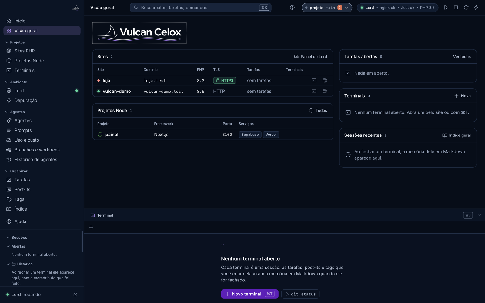
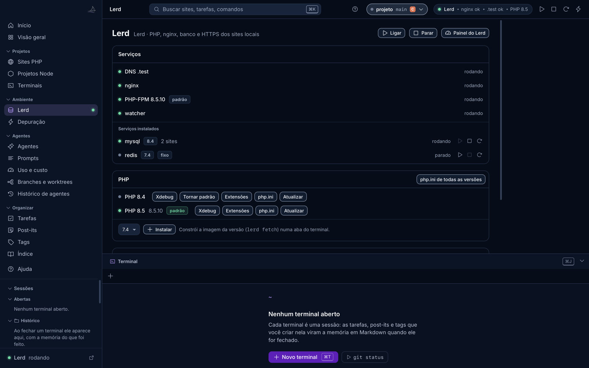
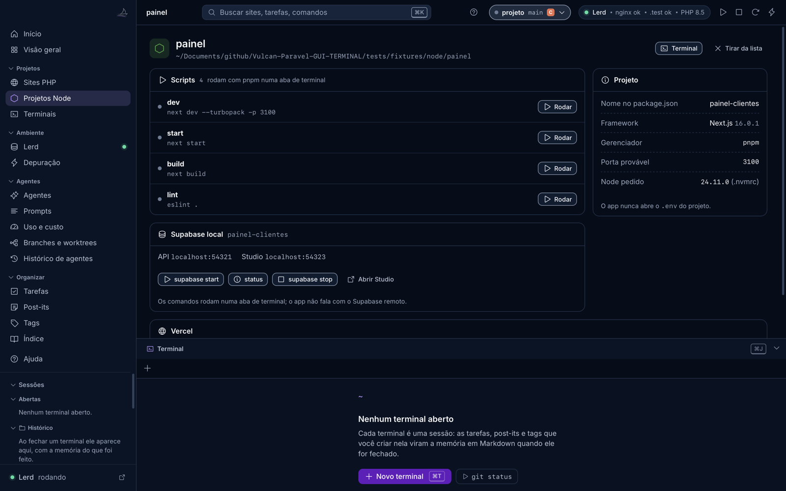
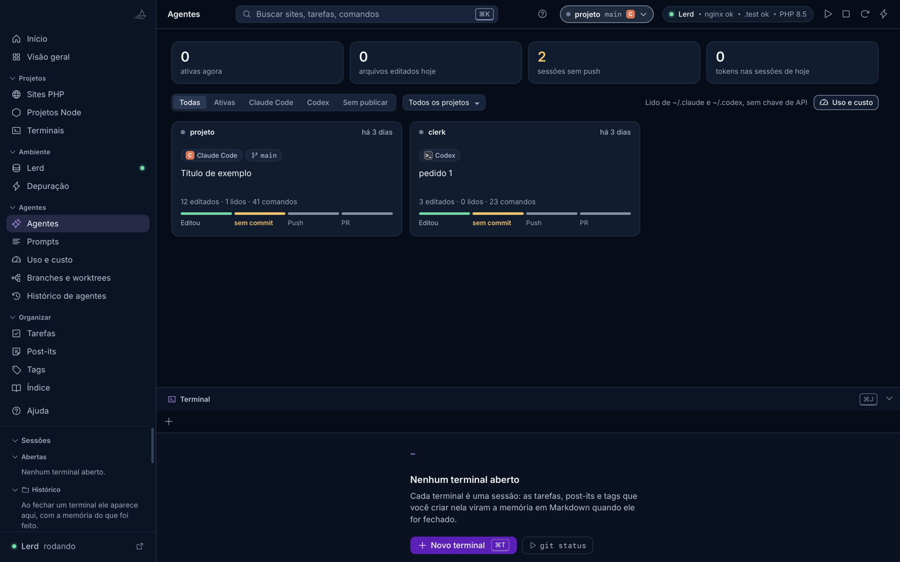
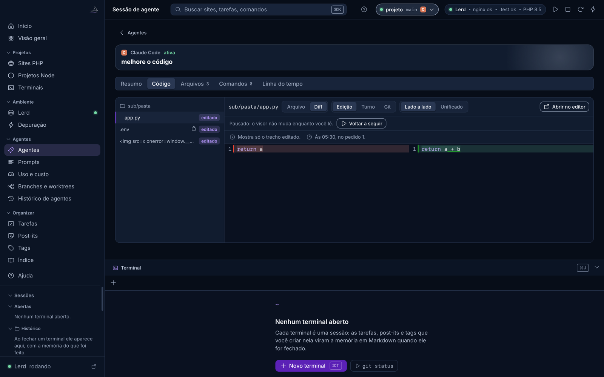
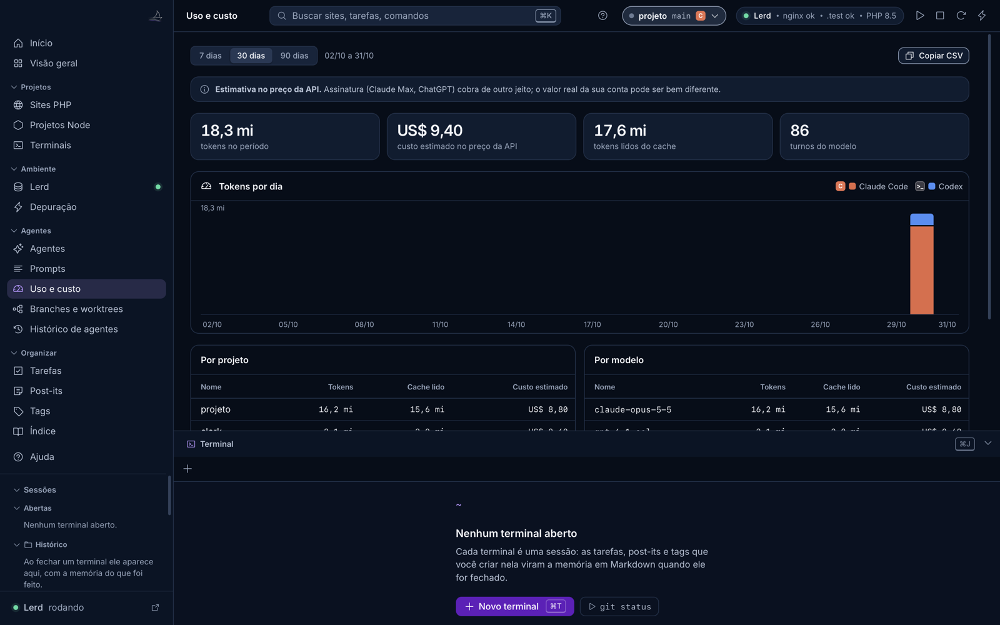
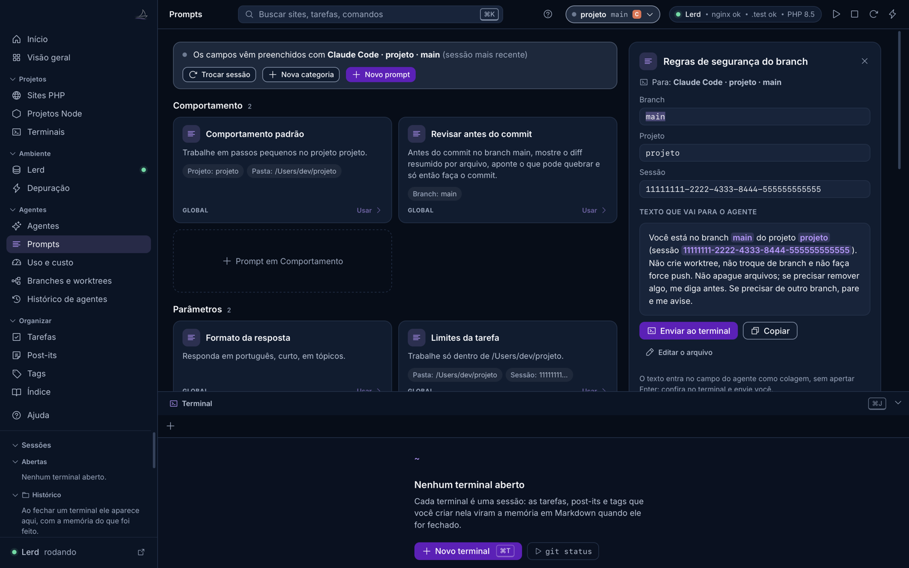
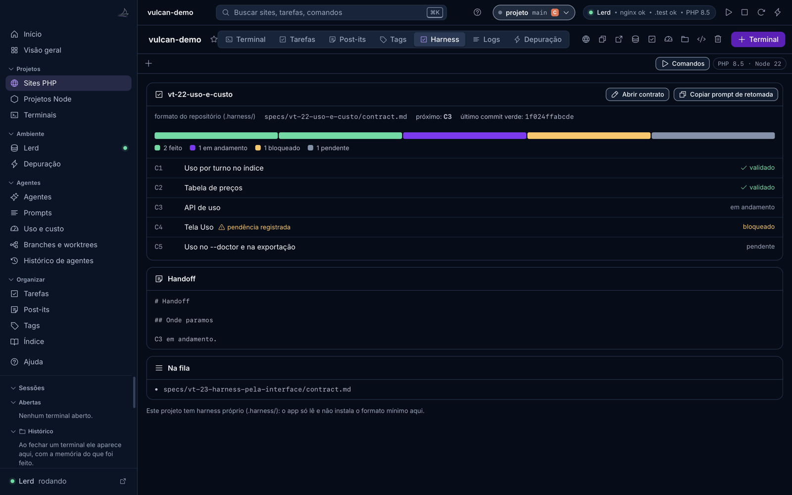

# Manual do Vulcan Celox

> Gerado por `scripts/manual_md.py` a partir de `vulcan_celox/web/help/conteudo.json`, o mesmo conteúdo da tela Ajuda do app (⌘?). Não edite este arquivo à mão.

## Sumário

- [Primeiros passos](#primeiros-passos): O que o Vulcan Celox faz e como começar em quatro passos.
- [Sites PHP](#projetos-php): Sites do Lerd: abrir, trocar PHP, HTTPS, logs e terminal.
- [Lerd](#lerd): O ambiente que roda PHP, nginx, banco e HTTPS dos sites.
- [Projetos Node](#node): Next.js, Vite, Supabase local e vínculo com a Vercel.
- [Terminais e sessões](#terminais): Abas, painel de baixo e a memória de cada sessão.
- [Depuração e logs](#depuracao): Dumps, queries, exceções e o laravel.log.
- [Agentes](#agentes): Sessões do Claude Code e do Codex lidas do disco.
- [Uso e custo](#custo): Tokens e custo estimado por dia, projeto, modelo e sessão.
- [Prompts](#prompts): Instruções prontas que você manda ao agente com um clique.
- [Harness](#harness): Contrato, itens e handoff que os agentes seguem.
- [Tarefas, post-its, tags e índice](#organizar): O que fica registrado de cada projeto.
- [Atalhos de teclado](#atalhos): Os atalhos que mais economizam tempo.
- [Segurança e privacidade](#seguranca): O que o app lê, o que grava e o que nunca faz.
- [Perguntas frequentes](#perguntas-frequentes)

## Primeiros passos

*O que o Vulcan Celox faz e como começar em quatro passos.*

O app tem tema claro e escuro. Em ⌘K, busque "Tema" e escolha Sistema, Claro ou Escuro. A área do terminal fica escura nos dois, com a cor de cada aba.

O Vulcan Celox é um painel para quem programa sozinho com agentes de código. Ele junta num lugar só os sites PHP que o **Lerd** roda no seu Mac, os projetos Node (Next.js, Vite e afins), os terminais de cada projeto e as sessões do **Claude Code** e do **Codex**.

1. **Ligue o Lerd.** O ponto verde no alto, à direita, e no item Lerd da barra lateral mostra que nginx, DNS `.test` e PHP respondem. Sem o Lerd, projetos Node e agentes funcionam do mesmo jeito.
2. **Encontre seus projetos.** Sites registrados no Lerd aparecem sozinhos. Projetos Node entram pelo + da seção Projetos Node, ou pelas sugestões tiradas das pastas onde seus agentes trabalharam.
3. **Deixe o app ler as sessões dos agentes.** Ele lê os arquivos do Claude Code e do Codex do disco, linha por linha, sem chave de API e sem escrever nada nessas pastas.
4. **Abra um terminal num projeto** com ⌘T. Tarefas, post-its e tags criados nele viram a memória da sessão em Markdown quando o terminal fecha.

A tela **Início** confere esses passos sozinha e sai da abertura do app quando os quatro estão feitos. Marque **Não mostrar mais o guia** para o app abrir direto na Visão geral. O guia continua no item Início da barra lateral.

## Sites PHP

*Sites do Lerd: abrir, trocar PHP, HTTPS, logs e terminal.*

Cada site do Lerd aparece na Visão geral e na seção Sites da barra lateral, com domínio `.test`, versão de PHP e HTTPS. Clicar num site abre a página dele, com abas para terminal, tarefas, post-its, logs, depuração e harness.

- **Adicionar site:** o + da seção Sites liga uma pasta a um domínio (`lerd link`) ou registra uma pasta cheia de projetos (`lerd park`). O Lerd grava `.php-version` na pasta ao registrar.
- **Trocar PHP, HTTPS ou Node do site:** pela página do site. Ações que constroem imagem rodam numa aba de terminal, com a saída à vista.
- **Compartilhar:** abre um túnel público e mostra o endereço quando ele aparece na saída.
- **Remover:** tirar da lista do app não apaga nada. Apagar a pasta manda para a Lixeira, nunca de forma definitiva.

Os sites são do Lerd. O app só chama a CLI e a API do próprio Lerd e nunca edita os arquivos globais dele.

## Lerd

*O ambiente que roda PHP, nginx, banco e HTTPS dos sites.*

O **Lerd** é um ambiente de desenvolvimento PHP de código aberto (licença MIT). Ele roda nginx, PHP-FPM, DNS para `.test`, banco de dados e certificados HTTPS em contêineres, sem você configurar servidor web na mão. O Vulcan Celox é o painel por cima dele.

- **Item Lerd na barra lateral:** o ponto mostra o estado (verde rodando, rosa parado, cinza ausente). A tela tem Ligar, Parar e Painel do Lerd.
- **Serviços:** banco, Redis e outros, com ligar e parar.
- **PHP:** versões instaladas, extensões, Xdebug e seis ajustes comuns do php.ini, gravados pelo próprio `lerd php:ini`.
- **Node do Lerd:** versões que o Lerd gerencia para os sites PHP com front em JavaScript.
- **Iniciar com o app:** o botão de raio, no alto, liga o Lerd junto com o Vulcan Celox.

O Laravel Valet também funciona como alternativa. O Herd é comercial e não é usado.

## Projetos Node

*Next.js, Vite, Supabase local e vínculo com a Vercel.*

Projetos Node não usam o Lerd. O app lê o `package.json`, descobre o gerenciador pelo lockfile (pnpm, npm, yarn ou bun), o framework pelas dependências e a porta provável, e mostra o Supabase local e o vínculo com a Vercel.

1. Clique no + da seção **Projetos Node** e escolha a pasta raiz, onde fica o `package.json`. Nada é gravado nela.
2. Na página do projeto, **Rodar** abre uma aba de terminal e digita `pnpm run dev` (ou o gerenciador do projeto). A aba aparece no painel de baixo.
3. Quando o servidor mostra o endereço local, o botão **Abrir no navegador** aparece.
4. **Parar** manda Ctrl-C para a aba do próprio projeto. A aba continua aberta com a saída.

- **Supabase local:** com `supabase/config.toml` no projeto, os botões rodam `supabase start`, `status` e `stop` num terminal, e Abrir Studio leva ao painel local.
- **Vercel:** o app só mostra se a pasta está vinculada (`.vercel/project.json`). Deploy e logs ficam no painel da Vercel ou no `vercel` do terminal.
- O app nunca abre o `.env` do projeto e não fala com a Vercel nem com o Supabase remoto.

## Terminais e sessões

*Abas, painel de baixo e a memória de cada sessão.*

Cada terminal é uma sessão. Ele abre na pasta escolhida, com um tema de cor que identifica a sessão, e pode já começar com o Claude Code ou o Codex rodando.

- **Portas:** a aba mostra as portas que os processos dela abriram, como `:5173 +2`, na barra de abas e na lista de sessões. O clique abre `http://localhost:<porta>` no navegador. Só os processos da própria aba contam.
- **⌘T** abre um terminal novo; **⌘J** mostra ou esconde o painel de terminal de baixo, que acompanha todas as telas.
- **Comandos rápidos** do projeto (composer, artisan, npm) ficam na barra do terminal.
- **Memória:** ao fechar um terminal, os comandos, tarefas, post-its e tags dele viram um arquivo Markdown, que aparece em Sessões recentes e no Índice.
- **Destacar:** uma aba pode virar janela própria e voltar depois.

## Depuração e logs

*Dumps, queries, exceções e o laravel.log.*

A tela **Depuração** (⇧⌘E) mostra o que chega pela ponte de dumps do Lerd: `dump()`, queries, logs e exceções, agrupados por requisição, com aviso de query repetida. A aba Logs do site lê o `storage/logs/laravel.log` por nível.

Na sessão de um agente, o painel **Depuração no período** mostra só o que aconteceu enquanto o agente trabalhava, com um resumo que pode ser copiado e que passa antes por uma limpeza de segredos.

## Agentes

*Sessões do Claude Code e do Codex lidas do disco.*

A tela **Agentes** lista as sessões do Claude Code e do Codex desta máquina, com projeto, branch, último pedido, arquivos tocados e estado (ativa, parada, em loop). Clicar numa sessão abre a linha do tempo dela.

- **Quem espera por você:** a aba ganha um anel e a barra lateral mostra quantas sessões terminaram o turno ou podem estar esperando. O aviso some ao focar a aba ou abrir a sessão, e ⌘⇧U vai para o mais recente. "Talvez esperando" é uma suposição: a ferramenta pode só estar demorando. Programas que avisam pelo terminal (OSC 9, 99 e 777, ou o sino) também acendem o anel. Com a janela sem foco, o app manda um aviso do sistema só com agente, projeto e estado, e mostra o número no ícone do Dock; para ligar ou desligar, use ⌘K e busque "Aviso do sistema".
- **Histórico de agentes:** busca em tudo o que os agentes fizeram, por texto, arquivo ou comando.
- **Branches e worktrees:** em que branch cada agente está trabalhando, para não misturar trabalho.
- **Retomar:** abre um terminal na pasta da sessão já com o comando de retomada do agente.
- **Pareamento:** o terminal que abriu um agente fica ligado à sessão dele, para os prompts saírem preenchidos. No Codex a ligação é por pasta e horário: duas sessões abertas quase juntas na mesma pasta ainda podem trocar de aba. Subagentes e o app desktop do Codex não se ligam a abas.

**⌘-clique em caminho.** No terminal, com ⌘ pressionado, caminhos como `a/b.py`, `/abs/b.py`, `b.py:12` e `b.py(12)` viram links, se o arquivo existir dentro de uma pasta conhecida. Com sessão pareada, abre na aba Código, na linha. Sem sessão, abre no editor. Pasta abre no Finder. Caminho relativo conta a partir da pasta da sessão ou da pasta em que a aba abriu: depois de um `cd`, ele pode não ser encontrado.

**Navegar por pedido.** ⌘⇧↑ e ⌘⇧↓ saltam entre os pedidos. No terminal, cada Enter numa aba com agente vivo vira uma marca, sem desenhar nada na tela. Se o agente usar a tela inteira do terminal, não há histórico para navegar, e o app avisa uma vez. Na sessão, a **Linha do tempo** agrupa por pedido, com arquivos e comandos, e cada arquivo editado leva ao diff daquele pedido.

**Estado do PR.** Por padrão o app estima pelos comandos da sessão e diz isso na tela. Ligue "Estado do PR pelo GitHub" no ⌘K para ver número, rascunho, estado e checagens pelo seu próprio `gh`. Só essa opção usa a rede.

**Aba Código.** Dentro de uma sessão, a aba **Código** mostra os arquivos que o agente tocou, com a marca de novo, editado, lido ou apagado. Você vê o arquivo com realce de sintaxe ou o diff: de uma edição, de um pedido inteiro ou contra o último commit, lado a lado ou unificado. ⌘F busca no arquivo. Numa sessão ativa o visor segue o agente, abrindo cada arquivo editado e rolando até o trecho. Rolar, clicar ou selecionar texto pausa, e **Voltar a seguir** retoma. Nas abas pareadas, o botão **Código** da barra acima do terminal leva direto para cá.

O visor só lê: nada é editado no app. Ele abre arquivos dentro da pasta da sessão, até 1 MB, e não mostra binários nem nomes sensíveis como `.env`, chaves e credenciais. O conteúdo das edições vem do registro do agente, então some quando o agente apaga a sessão antiga.

O app só lê esses arquivos, linha por linha. Ele nunca escreve em `~/.claude` nem em `~/.codex`. A única exceção é o hook de pareamento, que você instala de propósito com `--instalar-hook`, e que guarda um backup.

## Uso e custo

*Tokens e custo estimado por dia, projeto, modelo e sessão.*

A tela **Uso e custo** soma os tokens que cada turno dos agentes gastou e estima o custo pelo preço público da API de cada modelo, por dia, projeto, modelo e sessão. O botão Copiar CSV leva os números para uma planilha.

O valor é uma **estimativa no preço da API**. Quem usa plano de assinatura paga outro valor. Modelo sem preço conhecido aparece sem custo, nunca como zero. Os preços podem ser trocados no arquivo `precos.json` da pasta de dados do app.

## Prompts

*Instruções prontas que você manda ao agente com um clique.*

Prompts são instruções que você manda sempre para o agente: trabalhar em passos pequenos, revisar antes do commit, limites da tarefa. Cada cartão diz o que o prompt faz e mostra os dados que ele usa, como **Branch: main**, já preenchidos com a sessão atual.

1. **Clique no cartão.** Abre o compositor ao lado, com um campo para cada dado (projeto, branch, pasta, sessão) e a prévia do texto com os valores destacados.
2. **Confira ou ajuste os campos.** A prévia muda enquanto você digita. Campo vazio aparece em âmbar e bloqueia o envio até ser preenchido.
3. **Clique em Enviar ao terminal** (ou ⌘Enter). O texto entra no campo do agente como colagem, **sem apertar Enter**: confira no terminal e envie você.
4. **Sem terminal pareado, ou com o agente já fechado naquela aba,** o texto não é colado: assim ele não cai no shell. O compositor oferece retomar a sessão num terminal. Copiar continua disponível para colar em outro lugar com ⌘V.

- Prompts globais ficam na pasta de dados do app; os do projeto ficam em `.vulcan/prompts` dentro do projeto e sobrescrevem o global de mesmo id. Os caminhos aparecem no diálogo Novo prompt.
- No cabeçalho do arquivo, `descricao` define o texto do cartão e `icone` o ícone. Sem `descricao`, o cartão usa a primeira frase do prompt.
- Prompts fixados (`pin: true`) aparecem na barra do terminal. Na aba pareada a um agente, um clique cola o texto, também sem Enter.

## Harness

*Contrato, itens e handoff que os agentes seguem.*

O harness é o contrato com itens verificáveis, o estado da execução e o handoff que os agentes leem para retomar o trabalho. A aba **Harness** de cada site mostra o contrato ativo, a barra de itens (feito, em andamento, bloqueado, pendente), o próximo item e o último commit verde.

- **Copiar prompt de retomada:** texto pronto para o agente continuar do item certo.
- **Instalar harness:** num projeto sem harness, cria o formato mínimo depois de mostrar a lista exata de arquivos. Nada é sobrescrito; em `CLAUDE.md` ou `AGENTS.md` existente entra só um bloco marcado.
- **Novo contrato:** formulário que grava `.vulcan/tasks/<id>.md`, sempre com APROVAÇÃO pendente até você aprovar no arquivo.

## Tarefas, post-its, tags e índice

*O que fica registrado de cada projeto.*

- **Tarefas:** por site ou globais, com prazo e estado. As abertas aparecem na Visão geral.
- **Post-its:** notas rápidas por site ou globais.
- **Tags:** marcam sessões, tarefas e notas para achar depois.
- **Índice:** todas as memórias de sessão em Markdown, com busca. A documentação com IA é opcional, só por clique, e usa a sua própria chave da Anthropic guardada no Keychain.

## Atalhos de teclado

*Os atalhos que mais economizam tempo.*

| Atalho | Faz |
|--------|-----|
| `⌘K` | Buscar sites, projetos, tarefas e comandos |
| `⌘T` | Terminal novo |
| `⇧⌘T` | Terminal novo perguntando a pasta |
| `⌘J` | Mostrar ou esconder o painel de terminal |
| `⌘⇧U` | Ir para o aviso de agente mais recente |
| `⌘F` | Buscar no terminal |
| `⇧⌘P` | Prompts |
| `⇧⌘E` | Depuração |
| `⌘1 a ⌘5` | Visão geral, Terminais, Tarefas, Post-its e Tags |
| `⌘?` | Ajuda |

## Segurança e privacidade

*O que o app lê, o que grava e o que nunca faz.*

- O servidor interno só atende em `127.0.0.1`, com um token por execução. Nada fica exposto na rede.
- Sessões dos agentes: só leitura, linha por linha. O app nunca escreve em `~/.claude`, `~/.codex` ou nos arquivos de configuração deles, exceto o hook de pareamento que você instala de propósito, com backup.
- Nada é apagado de forma definitiva: pasta removida vai para a Lixeira.
- Em pasta de projeto, o app só escreve com a sua confirmação e dentro de um bloco marcado.
- O `.env` dos projetos nunca é aberto.
- A chave da Anthropic, se você cadastrar uma, fica no Keychain e só é usada quando você clica para documentar uma sessão.

## Perguntas frequentes

**Para que serve o Lerd?**

É o ambiente que roda seus sites PHP e Laravel no Mac: domínio `.test`, versão de PHP por projeto, banco e HTTPS local, sem configurar servidor na mão. O Vulcan Celox é o painel por cima dele.

**Preciso do Lerd para usar o app?**

Não. Sem Lerd nem Valet o app abre em modo local: projetos Node, terminais, agentes, prompts, tarefas e notas funcionam. Só a parte de sites PHP fica limitada.

**Meu projeto é Next.js com Supabase e Vercel. O app ajuda?**

Sim. Adicione a pasta em Projetos Node: o app liga e para o servidor de desenvolvimento num terminal à vista, mostra a porta, roda `supabase start` e `stop` e indica se a pasta está vinculada à Vercel.

**O Lerd está parado. Como ligo?**

Clique em Ligar na tela Lerd, ou no botão de play no alto. A primeira vez pode levar até um minuto, porque o Lerd sobe os contêineres. Para ligar sempre junto com o app, use o botão de raio.

**Cliquei em Rodar e não vi nada.**

O script roda numa aba do painel de terminal de baixo. Se o painel estiver escondido, aperte ⌘J. A aba tem o nome do projeto e do script.

**O servidor diz que a porta já está em uso.**

Outro processo usa a mesma porta, muitas vezes um `dev` antigo esquecido. Pare o script pela página do projeto ou feche a aba antiga. O app não mata processo por porta: só manda Ctrl-C para as abas do próprio projeto.

**O app escreve nas pastas do Claude Code ou do Codex?**

Não. Ele só lê as sessões, linha por linha. A única exceção é o hook de pareamento, que você instala de propósito com `--instalar-hook`, e que guarda um backup do arquivo original.

**O custo mostrado é o que eu paguei?**

Não. É uma estimativa pelo preço público da API de cada modelo. Quem usa plano de assinatura paga outro valor. Modelo sem preço aparece sem custo, nunca como zero.

**Como mudo o preço de um modelo?**

Edite o `precos.json` na pasta de dados do app (`~/Library/Application Support/VulcanCelox/`). O valor do arquivo vale mais que a tabela embutida.

**Um agente não aparece na lista.**

O app lê o Claude Code e o Codex. Sessões do Codex compactadas (`.jsonl.zst`) são lidas quando o comando `zstd` está instalado; sem ele, ficam de fora e o `--doctor` conta quantas são. Gemini e Cursor não estão entre os agentes lidos por enquanto.

**Por que um campo do prompt aparece em âmbar?**

Falta esse dado na sessão atual, por exemplo o branch. Preencha o campo no compositor ou escolha outra sessão em Trocar sessão. Enquanto houver campo vazio, Enviar ao terminal fica bloqueado.

**Onde ficam os prompts?**

Arquivos `.md`: os globais na pasta de dados do app e os do projeto em `.vulcan/prompts` dentro do projeto. Os caminhos exatos aparecem no diálogo Novo prompt.

**O que acontece quando fecho um terminal?**

Os comandos, tarefas, post-its e tags dele viram um arquivo Markdown de memória. Ele aparece em Sessões recentes, na Visão geral, e no Índice.

**Removi um site por engano. Perdi a pasta?**

Não. Tirar da lista não apaga nada. Mesmo quando você pede para apagar a pasta, ela vai para a Lixeira do Mac e pode ser restaurada.

**O que é o harness?**

É o contrato que os agentes seguem: itens com sensor, estado da execução e handoff. A aba Harness mostra em que item o trabalho está e o que está bloqueado.

**Instalar o harness mexe nos meus arquivos?**

Só com a sua confirmação, e depois de mostrar a lista exata. Arquivo existente nunca é sobrescrito; em `CLAUDE.md` ou `AGENTS.md` entra só um bloco marcado, que pode ser trocado depois.

**Como vejo o guia do Início de novo?**

Clique em Início na barra lateral. Para ele voltar a abrir junto com o app, desmarque Não mostrar mais o guia.

**Abri pelo navegador e pede token.**

A interface precisa do token que o app nativo cria a cada execução. Abra pelo Vulcan Celox, no atalho da Mesa ou em Aplicativos.

**O prompt enviado ao terminal já executa?**

Não. O texto entra no campo do agente como colagem e nada é enviado sozinho. Você revisa no terminal e aperta Enter.
